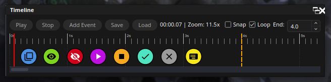

# Timeline for OBS

**Compose your stream on a timeline. Control it live with Macro Strip.**

Timeline is a native OBS Studio plugin for arranging scene changes, effects,
media and other actions into timed sequences. Its companion Macro Strip dock
lets you build a compact control surface with buttons, sliders, knobs, toggles and
text entry.



*Timeline dock — earlier preview screenshot.*

[Installation](#installation) · [Timeline](#timeline) · [Macro Strip](#macro-strip) ·
[Shortcuts](#keyboard-shortcuts) · [Documentation](#documentation)

> [!NOTE]
> Early preview (`v0.1.0-preview.1`). Linux source builds and CI packages are
> available for testing. There is no tagged release yet. Back up your OBS
> scene collections and test before using it live.

## Timeline

Build reusable sequences without leaving OBS.

- Place, drag and edit events directly on the timeline.
- Snap to time intervals or musical beats using BPM and note subdivisions.
- Scrub, play, pause, stop, restart or loop at a defined end marker.
- Customize event colors, labels, SVG icons and durations.
- Copy, paste, delete and nudge selections; undo or redo the last 100 edits.
- Zoom, use compact mode, or scroll through stacked event lanes.
- Save automatically, import/export JSON and trigger nested timelines.

### Available actions

| Action | What it does |
| --- | --- |
| Scene Switch | Switch scenes, optionally with a named transition. |
| Source Visibility | Show or hide a scene item, including nested sources and groups. |
| Media Playback | Restart, stop, pause, resume or seek a media source. |
| Filter Visibility | Enable or disable a source filter. |
| Set Parameter Value | Set a numeric, boolean or text source/filter property to a defined value. |
| Hotkey Trigger | Run an OBS or third-party plugin hotkey. |
| Trigger Timeline | Play another saved timeline. |
| Downstream Keyer Scene | Select or hide an overlay scene in a named keyer (optional integration). |

Visibility, filter and compatible media actions can have a duration, with
an inverse action at the end. Seek and parameter-value cues are instantaneous.
See [action behavior](docs/USAGE.md#action-behavior) for the details.

### Create your first sequence

1. Open **View → Docks → Timeline**.
2. Click **Add Event**, or double-click an empty part of the timeline.
3. Choose an action and its target. Set a duration if needed.
4. Drag the event to its desired time, or edit its exact timestamp.
5. Press **Play**.

### Set a parameter at a specific time

Choose **Set Parameter Value → Choose parameter and value**, then select
a source or filter, its property, and the desired value.

For example, three cues could control a HyperShaderFX filter's effect opacity:

| Time | Property | Value |
| --- | --- | ---: |
| 0 s | Effect Opacity | 0.00 |
| 2 s | Effect Opacity | 1.00 |
| 6 s | Effect Opacity | 0.25 |

Each cue applies its value when playback reaches it. The value stays set until
another cue or manual adjustment changes it. This is a step change, not a
keyframe ramp.

## Macro Strip

Build a small control surface for your OBS setup. Open
**View → Docks → Macro Strip** and use **+** to add an action button or a
parameter control.

| Control | Example use |
| --- | --- |
| Action button | Switch scenes, run a hotkey or apply a parameter preset. |
| Slider | Adjust mixer volume, effect opacity or another numeric property. |
| Knob | Adjust shader speed or intensity. |
| Toggle | Mute an audio source or turn a boolean setting on or off. |
| Text entry | Edit a source caption or another exposed string property. |

### Assign a live control

1. Click **+ → Parameter control**.
2. Select a source or filter, then one of its available parameters.
3. Choose a compatible control and give it a label.
4. Adjust it directly in the dock. Right-click to edit, reorder or remove it.

The parameter picker discovers compatible OBS properties dynamically, including
those exposed by third-party plugins. Controls inherit the declared range,
step and units and reflect changes made elsewhere in OBS, including scheduled
Timeline cues. Saved bindings follow source/filter identities through renames.

Knobs use vertical dragging, with no value jump on click. Hold **Shift** for
10× finer movement, or focus a knob and use the wheel or arrow keys.

Audio sources also expose **Mixer / Volume** and **Mixer / Mute**. Volume
uses OBS’s logarithmic fader curve with a dB readout; both can be scheduled
with Set Parameter Value.

Numeric, boolean and editable text properties are supported. Text fields
apply changes explicitly; multiline fields open a larger editor without
growing the dock. Password and informational fields are excluded. Color,
list controls, custom ranges and scene-item transforms are not yet supported. See [live control details](docs/USAGE.md#live-parameter-controls).

## Installation

Choose the build matching your OBS major version. Do not mix plugin variants.

| OBS version | Availability |
| --- | --- |
| 31 | Linux, Windows and macOS builds (macOS 12+). |
| 32 | Linux, Windows and macOS builds (macOS 13+). |
| 33 | Experimental Linux compatibility target. |

Preview CI artifacts are available from [GitHub Actions](https://github.com/myrqyry/timeline/actions).
Windows and macOS runtime installation and interactive testing remain outstanding.

### Build from source (Linux)

Requirements: CMake 3.28+, C++17, Qt6 development packages, Ninja and matching
libobs development headers/libraries. Close OBS before installing.

```bash
cmake --preset ubuntu-x86_64 -DTIMELINE_OBS_COMPATIBILITY=obs32
cmake --build --preset ubuntu-x86_64
cmake --install build_x86_64
```

Use `obs31` for OBS 31 and a separate build directory when switching SDKs.
See [PACKAGING.md](PACKAGING.md) for dependencies, other targets, custom install
paths and optional WebSocket support.

Restart OBS and enable the Timeline and Macro Strip docks.

## Keyboard shortcuts

| Shortcut | Action |
| --- | --- |
| Space | Play / pause |
| Home | Seek to start |
| Delete | Delete selected events |
| Left / Right | Nudge selected events by 1 second |
| Shift + Left / Right | Nudge by 100 ms |
| Ctrl + C / V | Copy / paste events |
| Ctrl + Z | Undo |
| Ctrl + Shift + Z (platform redo) | Redo |
| Ctrl + mouse wheel | Zoom timeline |
| Shift + mouse wheel | Scroll vertically when event lanes overflow |

Use **Settings → Compact mode** to shrink the Timeline toolbar and events
together. Undo/redo is session-only, edits event data rather than live OBS
state, and is disabled during playback.

## Compatibility and saved state

Timeline and Macro Strip save automatically to OBS's plugin configuration
directory. On Linux this is `~/.config/obs-studio/plugin_config/timeline/`.
Timeline documents can also be imported/exported as JSON.

New explicit target bindings survive renames and do not silently redirect
missing targets. Older name-based actions keep their existing behavior.
Back up saved timelines and macros before downgrading: older versions may
skip new actions or controls and discard them when saving.

Only play timeline files you trust; they can change your OBS state.

## Development status

- **89/89 tests passing** in the local native OBS32 build, including
  owner-aware hotkeys, native mixer bindings, text controls and theme refresh
  (November 18, 2026). Qt widgets and libobs are real; frontend
  interactions in the harness use test doubles.
- Build `68ab09a` loaded both docks and the WebSocket vendor in an
  isolated OBS 32.2.0 session. The newer hotkey, mixer, text and theme changes still require native
  interactive testing.
- HyperShaderFX effect opacity and a shader uniform have been verified through
  the real plugin's property interface; rendered output has not been verified.
- Additional multi-selection editing, HTTP actions and release-grade
  cross-platform installers remain planned work.

## Documentation

| Guide | Contents |
| --- | --- |
| [Usage guide](docs/USAGE.md) | Detailed action behavior, live controls, hotkeys, integrations and saved state. |
| [Build and packaging](PACKAGING.md) | SDKs, dependencies, artifacts and install paths. |
| [Architecture](docs/ARCHITECTURE.md) | Runtime boundaries, event formats, scheduling and persistence. |
| [Release checklist](docs/RELEASE_CHECKLIST.md) | Verification evidence, test commands and remaining release gates. |
| [Contributor instructions](AGENTS.md) | Repository conventions and development workflow. |

## License

GPL-2.0-or-later.
