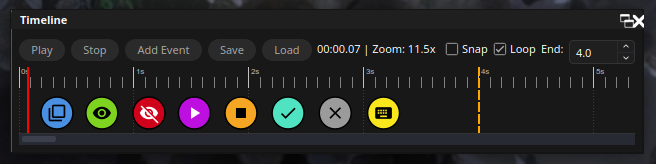

# Timeline for OBS

Timeline for OBS is an OBS Studio dock plugin for scheduling scene switches,
source visibility, media control, filter changes, hotkeys, and nested timeline
files on a visual timeline.



<!-- prettier-ignore -->
> [!IMPORTANT]
> Timeline for OBS is an early preview. Linux source builds and CI-generated
> packages for Windows/macOS are available for testing, but a tagged release
> and real-OBS runtime validation across platforms are still outstanding.
> Back up important scene collections before using it in a production stream.

## Current status

The current development milestone is `v0.1.0-preview.1`. The plugin builds
from source and installs locally; no packaged GitHub Release is published yet.

The implementation targets C++17, Qt6, and the OBS frontend/libobs APIs. CI
builds separate OBS Studio 31.1.2 and 32.2.1 artifacts for Linux, Windows,
and macOS. The Linux workflow also runs the Qt regression suite using a
virtual X display. An isolated Linux OBS 32 session has verified actual source
hide/restore, scene switching, Macro Strip migration and backup precedence.
This does **not** establish interactive editor coverage or Windows/macOS runtime
compatibility. The last fully verified CI baseline and outstanding release
gates are recorded in [`docs/RELEASE_CHECKLIST.md`](docs/RELEASE_CHECKLIST.md).

## Features

Timeline for OBS exposes nine event types in the editor. `MediaSeek` remains a
reserved model value and is not exposed in the UI
(`src/event-types.h:8-19`, `src/event-editor.cpp:44-53`).

### Timeline editing

- Add an event at the playhead, a context-menu position, or an empty-area
  double-click position.
- Drag event bubbles with optional time or BPM snapping.
- Edit event type, target, color, custom SVG icon, duration, and label.
- Stack events whose bubbles would overlap visually.
- Zoom through stepped levels from 5 to 1,000 pixels per second.
- Scrub the playhead and drag the optional end marker.
- Import and export timeline JSON documents.

### Scheduled actions

- **Scene switch:** Switch to an OBS scene, optionally using a named transition.
- **Source show/hide:** Change visibility for a source in the current scene or
  scene collection.
- **Media start/stop:** Restart or stop supported media sources.
- **Filter enable/disable:** Toggle a named filter on a source.
- **Hotkey trigger:** Trigger a registered OBS hotkey by name.
- **Nested timeline:** Start another JSON timeline without opening another dock.

Events with a positive duration emit an end action where the action has a
meaningful inverse. Source visibility and filter events reverse their state;
media events start or stop media. Scene switches, hotkeys, and nested timeline
triggers do not perform an end action
(`src/obs-executor.cpp:110-162`).

Named scene transitions are restored after the OBS frontend transition duration,
with a fallback delay when OBS reports no duration. A single timer prevents
overlapping restorations from rapid consecutive scene switches
(`src/obs-executor.cpp:189-227`).

### Playback controls

- Set an end time and either stop or loop at that position.
- Pause, resume, stop, restart, seek, and nudge selected events.
- Use Time mode for a manual snap interval or BPM mode for beat subdivisions.
- Persist zoom, snap, end time, loop, BPM, and display settings.

### Macro Strip

Macro Strip is a second OBS dock containing reusable, immediate actions. Clicking
a macro creates a temporary event and sends it through the same `ObsExecutor` as
the timeline, so the two docks share action behavior
(`src/plugin-main.cpp:61-68`, `src/macro-strip-dock.cpp:112-125`).

### Optional WebSocket vendor

When the OBS WebSocket vendor header is available at build time, the plugin can
emit `TimelineEvent` and playback status events. The event payload includes the
phase, numeric type, source name, and event time; OBS WebSocket remains
responsible for transport and authentication
(`src/obs-executor.cpp:75-88`, `src/plugin-main.cpp:105-125`).

## Installation

The current supported installation path is a Linux source build. The build
requires the OBS development packages, Qt6 development packages, CMake 3.28 or
newer, and a C++17 toolchain.

### Prerequisites

On Debian or Ubuntu, install the required development packages with your
distribution’s package manager. The minimum project components are:

- `libobs-dev`
- `cmake` 3.28 or newer
- Qt6 Core, Gui, Widgets, and Svg development packages
- A C++17 compiler and standard build tools
- Optional: `obs-websocket-api.h` for WebSocket vendor support

The exact CI dependency list is in `.github/workflows/linux-build.yml:15-24`.

### Build and install

Select the OBS major version before configuring. Each compatibility target uses
its own OBS headers and libraries, so don't reuse a build directory when
switching targets.

Run these commands from the repository root:

```bash
# Using CMake presets (recommended):
cmake --preset ubuntu-x86_64 -DTIMELINE_OBS_COMPATIBILITY=obs32
cmake --build --preset ubuntu-x86_64
cmake --install build_x86_64

# Or without presets:
cmake -S . -B build -DCMAKE_BUILD_TYPE=RelWithDebInfo \
  -DTIMELINE_OBS_COMPATIBILITY=obs32
cmake --build build
cmake --install build
```

Use `obs31` instead of `obs32` to build the OBS 31 artifact. CI enables
`TIMELINE_BUILD_OBS_FROM_SOURCE=ON` to build the selected OBS SDK from its
pinned source archive. Local builds use the installed OBS SDK by default and
fail if its major version doesn't match the selected target.

OBS 31 artifacts support macOS 12 and newer. OBS 32 artifacts require macOS 13
or newer because OBS 32.2.1 uses a Qt version that no longer supports macOS 12.

The default Linux install locations are:

- Plugin: `~/.config/obs-studio/plugins/timeline/bin/64bit/timeline.so`
- Plugin data: `~/.config/obs-studio/plugins/timeline/data/`

The install root and destinations are configurable through
`TIMELINE_PLUGIN_ROOT`, `OBS_PLUGIN_DESTINATION`, and
`OBS_DATA_DESTINATION` (`CMakeLists.txt:107-129`).

Restart OBS after installation, then open **View > Docks > Timeline**. Macro
Strip appears under **View > Docks > Macro Strip**.

### WebSocket build option

`ENABLE_OBS_WEBSOCKET_VENDOR` defaults to `ON`. When enabled, CMake searches for
`obs-websocket-api.h`; when disabled, the vendor integration is compiled out
(`CMakeLists.txt:86-105`). For an explicit build without the integration, run:

```bash
cmake --preset ubuntu-x86_64 -DENABLE_OBS_WEBSOCKET_VENDOR=OFF
cmake --build --preset ubuntu-x86_64
```

## Usage

Use the following workflow to create and test a timeline in OBS.

1. Open **View > Docks > Timeline**.
2. Click **Add Event** to place an event at the playhead, double-click empty
   timeline space, or right-click empty timeline space and choose **Add Event
   Here**.
3. Select the event type and target in the editor.
4. Configure an optional duration, color, custom icon, or display label.
5. Drag the event to refine its position, or enable snapping in the toolbar.
6. Press **Play** or `Space` to start playback.

The Space shortcut is ignored while a line edit or combo box has focus, so text
and selection controls remain usable (`src/timeline-dock.cpp:684-690`).

### Keyboard shortcuts

| Shortcut | Action |
| --- | --- |
| `Space` | Play or pause |
| `Delete` | Remove selected events |
| `Home` | Seek to the start |
| `Left` / `Right` | Nudge selected events by 1 second |
| `Shift+Left` / `Shift+Right` | Nudge selected events by 100 ms |
| `Ctrl+C` / `Ctrl+V` | Copy and paste events |

OBS frontend hotkeys are also registered for play/pause, stop, and restart.

## Persistence

Timeline settings are saved automatically with a 250 ms debounce. OBS supplies
the timeline configuration path through `obs_module_get_config_path()`; on a
standard Linux OBS installation this is under the OBS plugin configuration
directory, not the installed plugin data directory
(`src/timeline-dock.cpp:221-304`).

Timeline and Macro Strip settings are stored in OBS's writable per-plugin
configuration directory. Timeline edits debounce for 250 ms and Macro Strip
edits for 300 ms. If a Macro Strip save fails, edits remain authoritative in
memory until a successful retry or shutdown; check OBS logs and free storage
before exiting if you see a save warning.

Linux default paths:

```text
~/.config/obs-studio/plugin_config/timeline/timeline.json
~/.config/obs-studio/plugin_config/timeline/macro_buttons.json
```

Existing Linux Macro Strip files under
`~/.config/obs-studio/plugins/timeline/data/macro_buttons.json` are imported
when the new config file does not exist. The original file is preserved.
Windows and macOS use their respective OBS plugin-configuration directories.
The current Macro Strip file is authoritative: copies stored in OBS scene
collections are recovery backups, not replacements for newer saved buttons or
edits awaiting autosave.

Timeline JSON accepts both the current root-object format and legacy bare event
arrays. Saves are atomic through `QSaveFile`
(`src/timeline-serialization.cpp:71-98`). See
[`docs/ARCHITECTURE.md`](docs/ARCHITECTURE.md#persistence-and-file-formats) for
the current schema and migration behavior.

## Safety and limitations

Timeline files are local configuration, but playing one can switch scenes,
change source visibility, control media, toggle filters, trigger hotkeys, and
start nested files. Import only files you trust.

The current preview has these limitations:

- It has been tested primarily on Linux with OBS test doubles in automated tests.
- Automated tests cannot prove every behavior of real OBS scenes, sources,
  transitions, filters, or media objects.
- Windows and macOS CI packages exist for testing, but have not yet passed
  real OBS runtime smoke tests; there is no tagged public release.
- `MediaSeek` exists in the data model but is not exposed by the editor.
- The plugin does not provide its own authentication or network listener.

For the complete failure-mode, threading, ownership, and deployment reference,
see [`docs/ARCHITECTURE.md`](docs/ARCHITECTURE.md).

## Development

The project uses CMake, Qt Test, and OBS frontend test doubles for headless
tests. The test target compiles production modules directly with those test
implementations (`tests/CMakeLists.txt:13-46`).

### Build and test

```bash
# Using CMake presets (recommended):
cmake --preset ubuntu-x86_64 -DTIMELINE_OBS_COMPATIBILITY=obs32
cmake --build --preset ubuntu-x86_64
TIMELINE_REQUIRE_OBS_RUNTIME=1 QT_QPA_PLATFORM=xcb \
  LIBGL_ALWAYS_SOFTWARE=1 xvfb-run -a \
  ctest --test-dir build_x86_64 --output-on-failure

# Or without presets:
cmake -S . -B build -DTIMELINE_OBS_COMPATIBILITY=obs32
cmake --build build
TIMELINE_REQUIRE_OBS_RUNTIME=1 QT_QPA_PLATFORM=xcb \
  LIBGL_ALWAYS_SOFTWARE=1 xvfb-run -a \
  ctest --test-dir build --output-on-failure
```

Run a focused test function with:

```bash
build_x86_64/tests/run_tests testSceneSwitch
build_x86_64/tests/run_tests testSchedulerStartCursorResets
```

The test harness defaults to `QT_QPA_PLATFORM=offscreen`, but OBS startup
requires a working OpenGL context. For strict validation use the Xvfb and
software-GL commands above (as in Linux CI). A local headless run can skip
if graphics or OBS startup is unavailable; `TIMELINE_REQUIRE_OBS_RUNTIME=1`
turns that into a test failure. Check **QTest passed/skipped counts** and CTest
status rather than treating a skip or graphics warning as a validated runtime.

### Source layout

The core runtime is split into these layers:

| Layer | Files | Role |
| --- | --- | --- |
| Module | `src/plugin-main.cpp` | OBS lifecycle and dock registration |
| Data | `src/event-types.h`, `src/timeline-model.cpp` | Event values and ordering |
| Timing | `src/timeline-scheduler.cpp` | Playhead and event timing |
| Execution | `src/obs-executor.cpp` | OBS operations |
| Presentation | `src/timeline-dock.cpp`, `src/timeline-event-item.cpp` | Timeline UI |
| Persistence | `src/timeline-serialization.cpp` | Timeline JSON |
| Nested runtime | `src/headless-timeline.cpp` | UI-free child timelines |
| Macro UI | `src/macro-strip-dock.cpp` | Immediate action buttons |

Read `AGENTS.md` before editing. The folder-specific instructions in `src/`,
`tests/`, and `data/` define ownership, threading, test, and asset rules.

### Formatting and conventions

- Use C++17 and follow the checked-in `.clang-format` (8-column tab indentation,
  120-column limit) instead of imposing an incompatible manual style.
- Use `blog(LOG_LEVEL, ...)`; do not use `printf`, `std::cout`, or similar
  output streams.
- Use OBS allocators (`bmalloc`, `bzalloc`, `bfree`) for OBS-owned memory.
- Use `QMetaObject::invokeMethod(..., Qt::QueuedConnection)` before touching Qt
  objects from OBS hotkey or frontend callback threads.
- Add new source files to `PLUGIN_SOURCES` in `CMakeLists.txt`.

## Release checklist

Before tagging a release, run the automated suite and complete the real OBS
smoke checks in [`docs/RELEASE_CHECKLIST.md`](docs/RELEASE_CHECKLIST.md).
At minimum, verify dock registration, event editing, save/load, all exposed
event types, looping, duration behavior, nested timelines, and optional
WebSocket builds.

## Roadmap

The following items are planned work rather than current capabilities:

- Undo and redo for timeline edits.
- Multi-selection for batch editing.
- Unified visibility event types.
- Tested, release-grade Windows and macOS installers.
- HTTP action events.

Do not describe roadmap items as supported features until their implementation,
tests, and release documentation exist.

## Contributing

Keep changes focused and update the relevant documentation when runtime
behavior changes.

1. Read `AGENTS.md` and the folder-specific instructions for the files you will
   change.
2. Add or update tests for observable runtime behavior.
3. Run the build and test commands before requesting review.
4. Keep commits scoped to one feature or fix.
5. Update `docs/ARCHITECTURE.md` when a change affects system boundaries or
   lifecycle behavior.

## License

Timeline for OBS is licensed under GPL-2.0-or-later.
