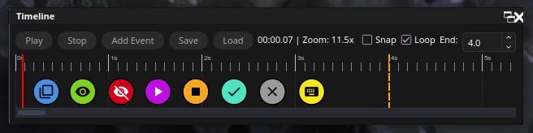

# Timeline for OBS

Timeline for OBS is an OBS Studio dock plugin for scheduling scene switches,
source visibility, media control, filter changes, hotkeys, and nested timeline
files on a visual timeline.



<!-- prettier-ignore -->
> [!IMPORTANT]
> Timeline for OBS is an early preview. Linux source builds and CI-generated
> packages for Windows/macOS are available for testing, but a tagged release
> and real-OBS runtime validation across platforms are still outstanding.
> Back up important scene collections before using it in a production stream.

## Current status

The current development milestone is `v0.1.0-preview.1`. The plugin builds
from source and installs locally; no packaged GitHub Release is published yet.

The implementation targets C++17, Qt6, and the OBS frontend/libobs APIs.
The project has OBS 31 and OBS 32 build targets for Linux, Windows, and macOS,
plus an explicit OBS 33.0.1 **Linux** CI target on Ubuntu 26.04. OBS 33 Linux
CI previously passed 46/46 strict tests at its compatibility checkpoint; that
does **not** validate newer changes or OBS 33 desktop use.

The latest local OBS 32 build passed **60/60 headless Qt/libobs tests** with no
skips. On November 12, 2026, that build was installed into native OBS Studio
32.2.0 and successfully loaded Timeline, Macro Strip, and the WebSocket vendor
in an isolated OBS session. The installed binary, locale and unchanged saved
configuration were verified. A manual live-editor walkthrough and cross-platform
runtime verification remain outstanding. See
[Release checklist](docs/RELEASE_CHECKLIST.md) for release gates.

## Features

The event editor offers six built-in action categories: Scene Switch, Source
Visibility, Media Playback, Filter Visibility, Hotkey Trigger, and Trigger
Timeline. A seventh category, Downstream Keyer Scene, appears when its supported
integration is loaded and enabled. Three paired categories have a separate
**Action** dropdown instead of duplicate entries. `MediaSeek` remains a reserved
model value and is not exposed in the UI. Existing serialized numeric event
types are unchanged.

### Timeline editing

- Add an event at the playhead, a context-menu position, or an empty-area
  double-click position.
- Drag event bubbles with optional time or BPM snapping.
- Edit event type, target, color, custom SVG icon, duration, and label.
- Stack events whose bubbles would overlap visually.
- Zoom through stepped levels from 5 to 1,000 pixels per second.
- Scrub the playhead and drag the optional end marker.
- Import and export timeline JSON documents.

### Scheduled actions

- **Scene switch:** Switch to an OBS scene, optionally using a named transition.
- **Source Visibility:** Choose Show or Hide for a source in the current scene
  or scene collection.
- **Media Playback:** Choose Restart or Stop for a supported media source.
- **Filter Visibility:** Choose Enable or Disable for a named source filter.
- **Hotkey Trigger:** Trigger a registered OBS hotkey, including hotkeys
  registered by third-party plugins such as Move. The hotkey selector supports
  search and group headings; see [Finding hotkeys](#finding-hotkeys).
- **Nested timeline:** Start another JSON timeline without opening another dock.
- **Downstream Keyer scene:** Select or hide a scene in a named downstream keyer,
  independently of the program scene. Requires Exeldro's Downstream Keyer and
  the OBS WebSocket API. The editor accepts a keyer name and an overlay scene;
  leave the scene blank to hide the overlay, or the view/canvas name blank to
  address the primary output. The target overlay scene must already belong to
  the named keyer's scene list.

Events with a positive duration emit an end action where the action has a
meaningful inverse. Source visibility and filter events reverse their state;
media events start or stop media. A timed Downstream Keyer overlay is hidden
when the duration ends; it does not restore a prior overlay. Ordinary scene
switches, hotkeys, and nested timeline triggers do not perform an end action.

Named scene transitions are restored after the OBS frontend transition duration,
with a fallback delay when OBS reports no duration. A single timer prevents
overlapping restorations from rapid consecutive scene switches
(`src/obs-executor.cpp:189-227`).

### Unified action picker

The Timeline event editor and Macro Strip share a compact action picker.
**Source Visibility** has Show/Hide, **Filter Visibility** has Enable/Disable,
and **Media Playback** has Restart/Stop. The selected operation appears in a
separate **Action** field, rather than creating duplicate event types in the
category list. "Restart" matches OBS's media-restart operation (not pause/resume).

This is an editor-only grouping: existing timeline and macro JSON numeric event
types remain unchanged, so previously saved Show/Hide, Start/Stop, and
Enable/Disable events load and edit with the correct operation selected. Timed
actions retain their existing inverse operation on duration end.

### Finding hotkeys

In **Timeline** or **Macro Strip**, add or edit an action, select **Hotkey
Trigger**, then use the search field above the target picker. Filter by action
description, registered hotkey ID, or source/group. The selector groups:

- Recognized **Move** filter hotkeys by the source that owns the matching filter.
- Other source-registered hotkeys by source name.
- Frontend / Plugins, Outputs, Encoders, and Services separately.

Group headings are not selectable. An existing event referencing an unregistered
hotkey keeps its original ID for later editing, even when the responsible plugin
is missing. This picker **does not change OBS Settings → Hotkeys** or assign
keyboard shortcuts. OBS exposes the registerer type, but not a reliable
originating-plugin identity for every frontend hotkey, so unverified plugins
are not guessed. Move animations remain controlled by Move itself; Timeline
only fires its registered hotkey.

### Playback controls

- Set an end time and either stop or loop at that position.
- Pause, resume, stop, restart, seek, and nudge selected events.
- Use Time mode for a manual snap interval or BPM mode for beat subdivisions.
- Persist zoom, snap, end time, loop, BPM, and display settings.

### Macro Strip

Macro Strip is a second OBS dock containing reusable, immediate actions. Clicking
a macro creates a temporary event and sends it through the same `ObsExecutor` as
the timeline, so the two docks share action behavior
(`src/plugin-main.cpp:61-68`, `src/macro-strip-dock.cpp:112-125`).

### Optional WebSocket vendor

When the OBS WebSocket vendor header is available at build time, the plugin can
emit `TimelineEvent` and playback status events. The event payload includes the
phase, numeric type, source name, and event time; OBS WebSocket remains
responsible for transport and authentication.

The optional Downstream Keyer action uses `obs_websocket_call_request` to invoke
`CallVendorRequest` for vendor `downstream-keyer`, request `dsk_select_scene`.
This is an **in-process OBS API call**, not a network connection: Timeline needs
no WebSocket credentials or enabled remote server. Missing plugin/vendor,
invalid keyer/scene, and API unavailability are reported in the OBS log.
Both scheduled events and Macro Strip buttons use this same action.

### Plugins & Integrations

Open Timeline's settings menu and choose **Plugins & Integrations** to see modules
currently loaded by OBS. Plugins with a Timeline action adapter have a checkbox;
checking it exposes their actions in the event editor **and** Macro Strip.
Downstream Keyer is the first supported adapter (requires OBS WebSocket support
at build time). Other loaded plugins are shown as detected but unavailable
until a matching action adapter is implemented.

These checkboxes control **which actions can be added**, not whether OBS
loads a plugin or whether previously saved events execute. A timeline or
macro containing an unavailable plugin action remains intact; editing it
retains its saved fields and marks the type unavailable instead of replacing
it. Timeline stores these preferences in `integrations.ini` in its writable
OBS module configuration directory; the timeline and macro JSON are unaffected.
The menu checks loaded modules, not every plugin file installed on disk;
a plugin that failed to load will not appear.

## Installation

The current supported installation path is a Linux source build. The build
requires the OBS development packages, Qt6 development packages, CMake 3.28 or
newer, and a C++17 toolchain.

### Prerequisites

On Debian or Ubuntu, install the required development packages with your
distribution’s package manager. The minimum project components are:

- `libobs-dev`
- `cmake` 3.28 or newer
- Qt6 Core, Gui, Widgets, Svg, and Test development packages (tests default to enabled)
- Ninja for the Ubuntu CMake presets
- A C++17 compiler and standard build tools
- Optional: `obs-websocket-api.h` for WebSocket vendor support

The exact CI dependency list is in the **Install dependencies** step of
`.github/workflows/linux-build.yml`. Plugin-only builds can disable the Qt Test
dependency with `-DTIMELINE_BUILD_TESTS=OFF`.

### Build and install

Select the OBS major version before configuring. Each compatibility target uses
its own OBS headers and libraries, so don't reuse a build directory when
switching targets.

Run these commands from the repository root:

```bash
# Using CMake presets (recommended):
cmake --preset ubuntu-x86_64 -DTIMELINE_OBS_COMPATIBILITY=obs32
cmake --build --preset ubuntu-x86_64
cmake --install build_x86_64

# Or without presets:
cmake -S . -B build -DCMAKE_BUILD_TYPE=RelWithDebInfo \
  -DTIMELINE_OBS_COMPATIBILITY=obs32
cmake --build build
cmake --install build
```

Use `obs31` instead of `obs32` for OBS 31. The `obs33`
compatibility target has been verified in Linux Ubuntu 26.04 CI but not in a
production OBS 33 GUI or a cross-platform release. CI can build the selected
OBS SDK from its pinned source archive; local builds use the installed OBS SDK
by default and fail if its major version differs from the selected target.

OBS 31 artifacts support macOS 12 and newer. OBS 32 artifacts require macOS 13
or newer because OBS 32.2.1 uses a Qt version that no longer supports macOS 12.

The default Linux install locations are:

- Plugin: `~/.config/obs-studio/plugins/timeline/bin/64bit/timeline.so`
- Plugin data: `~/.config/obs-studio/plugins/timeline/data/`

The install root and destinations are configurable through
`TIMELINE_PLUGIN_ROOT`, `OBS_PLUGIN_DESTINATION`, and
`OBS_DATA_DESTINATION` (the install rules in `CMakeLists.txt`).

Restart OBS after installation, then open **View > Docks > Timeline**. Macro
Strip appears under **View > Docks > Macro Strip**.

### WebSocket build option

`ENABLE_OBS_WEBSOCKET_VENDOR` defaults to `ON`. When enabled, CMake searches for
`obs-websocket-api.h`; when disabled, the vendor integration is compiled out
(`CMakeLists.txt`, **Optional obs-websocket vendor integration**). For an explicit
build without the integration, run:

```bash
cmake --preset ubuntu-x86_64 -DTIMELINE_OBS_COMPATIBILITY=obs32 \
  -DENABLE_OBS_WEBSOCKET_VENDOR=OFF
cmake --build --preset ubuntu-x86_64
```

## Usage

Use the following workflow to create and test a timeline in OBS.

1. Open **View > Docks > Timeline**.
2. Click **Add Event** to place an event at the playhead, double-click empty
   timeline space, or right-click empty timeline space and choose **Add Event
   Here**.
3. Select the event type and target in the editor.
4. Configure an optional duration, color, custom icon, or display label.
5. Drag the event to refine its position, or enable snapping in the toolbar.
6. Press **Play** or `Space` to start playback.

The Space shortcut is ignored while a line edit or combo box has focus, so text
and selection controls remain usable (`src/timeline-dock.cpp:684-690`).

### Keyboard shortcuts

| Shortcut | Action |
| --- | --- |
| `Space` | Play or pause |
| `Delete` | Remove selected events |
| `Home` | Seek to the start |
| `Left` / `Right` | Nudge selected events by 1 second |
| `Shift+Left` / `Shift+Right` | Nudge selected events by 100 ms |
| `Ctrl+C` / `Ctrl+V` | Copy and paste events |

OBS frontend hotkeys are also registered for play/pause, stop, and restart.

## Persistence

Timeline settings are saved automatically with a 250 ms debounce. OBS supplies
the timeline configuration path through `obs_module_get_config_path()`; on a
standard Linux OBS installation this is under the OBS plugin configuration
directory, not the installed plugin data directory
(`src/timeline-dock.cpp:221-304`).

Timeline and Macro Strip settings are stored in OBS's writable per-plugin
configuration directory. Timeline edits debounce for 250 ms and Macro Strip
edits for 300 ms. If a Macro Strip save fails, edits remain authoritative in
memory until a successful retry or shutdown; check OBS logs and free storage
before exiting if you see a save warning.

Linux default paths:

```text
~/.config/obs-studio/plugin_config/timeline/timeline.json
~/.config/obs-studio/plugin_config/timeline/macro_buttons.json
```

Existing Linux Macro Strip files under
`~/.config/obs-studio/plugins/timeline/data/macro_buttons.json` are imported
when the new config file does not exist. The original file is preserved.
Windows and macOS use their respective OBS plugin-configuration directories.
The current Macro Strip file is authoritative: copies stored in OBS scene
collections are recovery backups, not replacements for newer saved buttons or
edits awaiting autosave.

Timeline JSON accepts both the current root-object format and legacy bare event
arrays. Saves are atomic through `QSaveFile`
(`src/timeline-serialization.cpp:71-98`). See
[`docs/ARCHITECTURE.md`](docs/ARCHITECTURE.md#persistence-and-file-formats) for
the current schema and migration behavior.

## Safety and limitations

Timeline files are local configuration, but playing one can switch scenes,
change source visibility, control media, toggle filters, trigger hotkeys, and
start nested files. Import only files you trust.

The current preview has these limitations:

- It has been tested primarily on Linux with OBS test doubles in automated tests.
- Automated tests cannot prove every behavior of real OBS scenes, sources,
  transitions, filters, or media objects.
- Windows and macOS CI packages exist for testing, but have not yet passed
  real OBS runtime smoke tests; there is no tagged public release.
- `MediaSeek` exists in the data model but is not exposed by the editor.
- The plugin does not provide its own authentication or network listener.

For the complete failure-mode, threading, ownership, and deployment reference,
see [`docs/ARCHITECTURE.md`](docs/ARCHITECTURE.md).

## Development

The project uses CMake, Qt Test, and OBS frontend test doubles for headless
tests. The test target compiles production modules directly with those test
implementations (`tests/CMakeLists.txt`).

### Build and test

```bash
# Using CMake presets (recommended):
cmake --preset ubuntu-x86_64 -DTIMELINE_OBS_COMPATIBILITY=obs32
cmake --build --preset ubuntu-x86_64
TIMELINE_REQUIRE_OBS_RUNTIME=1 QT_QPA_PLATFORM=xcb \
  LIBGL_ALWAYS_SOFTWARE=1 xvfb-run -a \
  ctest --test-dir build_x86_64 --output-on-failure

# Or without presets:
cmake -S . -B build -DTIMELINE_OBS_COMPATIBILITY=obs32
cmake --build build
TIMELINE_REQUIRE_OBS_RUNTIME=1 QT_QPA_PLATFORM=xcb \
  LIBGL_ALWAYS_SOFTWARE=1 xvfb-run -a \
  ctest --test-dir build --output-on-failure
```

Run a focused test function with:

```bash
TIMELINE_REQUIRE_OBS_RUNTIME=1 QT_QPA_PLATFORM=xcb \
  LIBGL_ALWAYS_SOFTWARE=1 xvfb-run -a \
  build_x86_64/tests/run_tests testSceneSwitch
TIMELINE_REQUIRE_OBS_RUNTIME=1 QT_QPA_PLATFORM=xcb \
  LIBGL_ALWAYS_SOFTWARE=1 xvfb-run -a \
  build_x86_64/tests/run_tests testSchedulerStartCursorResets
```

The test harness defaults to `QT_QPA_PLATFORM=offscreen`, but OBS startup
requires a working OpenGL context. For strict validation use the Xvfb and
software-GL commands above (as in Linux CI). A local headless run can skip
if graphics or OBS startup is unavailable; `TIMELINE_REQUIRE_OBS_RUNTIME=1`
turns that into a test failure. Check **QTest passed/skipped counts** and CTest
status rather than treating a skip or graphics warning as a validated runtime.

### Source layout

The core runtime is split into these layers:

| Layer | Files | Role |
| --- | --- | --- |
| Module | `src/plugin-main.cpp` | OBS lifecycle and dock registration |
| Data | `src/event-types.h`, `src/timeline-model.cpp` | Event values and ordering |
| Timing | `src/timeline-scheduler.cpp` | Playhead and event timing |
| Execution | `src/obs-executor.cpp` | OBS operations |
| Presentation | `src/timeline-dock.cpp`, `src/timeline-event-item.cpp` | Timeline UI |
| Persistence | `src/timeline-serialization.cpp` | Timeline JSON |
| Nested runtime | `src/headless-timeline.cpp` | UI-free child timelines |
| Macro UI | `src/macro-strip-dock.cpp` | Immediate action buttons |

Read `AGENTS.md` before editing. The folder-specific instructions in `src/`,
`tests/`, and `data/` define ownership, threading, test, and asset rules.

### Formatting and conventions

- Use C++17 and follow the checked-in `.clang-format` (8-column tab indentation,
  120-column limit) instead of imposing an incompatible manual style.
- Use `blog(LOG_LEVEL, ...)`; do not use `printf`, `std::cout`, or similar
  output streams.
- Use OBS allocators (`bmalloc`, `bzalloc`, `bfree`) for OBS-owned memory.
- Use `QMetaObject::invokeMethod(..., Qt::QueuedConnection)` before touching Qt
  objects from OBS hotkey or frontend callback threads.
- Add new source files to `PLUGIN_SOURCES` in `CMakeLists.txt`.

## Release checklist

Before tagging a release, run the automated suite and complete the real OBS
smoke checks in [`docs/RELEASE_CHECKLIST.md`](docs/RELEASE_CHECKLIST.md).
At minimum, verify dock registration, event editing, save/load, all exposed
event types, looping, duration behavior, nested timelines, and optional
WebSocket builds.

## Roadmap

The following items are planned work rather than current capabilities:

- Undo and redo for timeline edits.
- Multi-selection for batch editing.
- Live-GUI acceptance testing for the newest editor actions on OBS 32 and
  OBS 33, followed by OBS 33 cross-platform validation.
- Tested, release-grade Windows and macOS installers.
- HTTP action events.

Do not describe roadmap items as supported features until their implementation,
tests, and release documentation exist.

## Contributing

Keep changes focused and update the relevant documentation when runtime
behavior changes.

1. Read `AGENTS.md` and the folder-specific instructions for the files you will
   change.
2. Add or update tests for observable runtime behavior.
3. Run the build and test commands before requesting review.
4. Keep commits scoped to one feature or fix.
5. Update `docs/ARCHITECTURE.md` when a change affects system boundaries or
   lifecycle behavior.

## License

Timeline for OBS is licensed under GPL-2.0-or-later.
