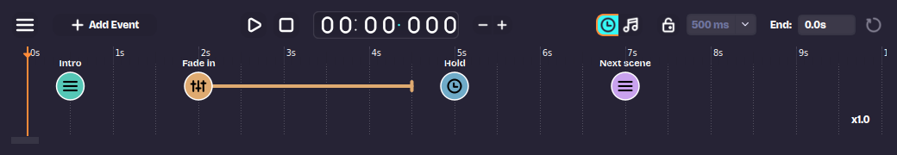
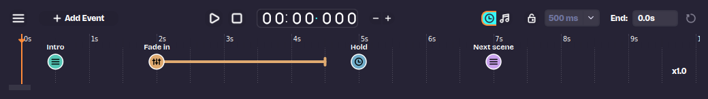
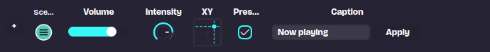
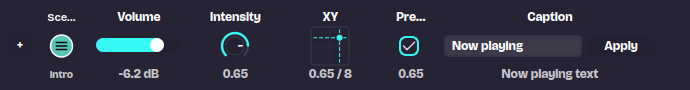
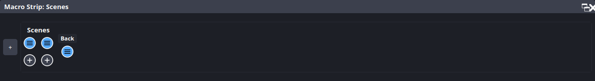
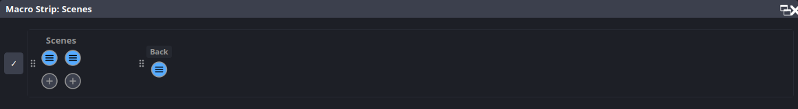
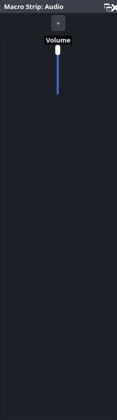

# Timeline for OBS

**Compose your stream on a timeline. Control it live with Macro Strip.**

Timeline is a native OBS Studio plugin with two complementary ways to control
your production: arrange scenes, effects, media and automation into timed
sequences, or build your own live control surface with Macro Strip.

- **Timeline:** sequence cues visually, animate parameters, and reuse complete timelines.
- **Macro Strip:** create named control banks or independent OBS docks with action grids, sliders, knobs, toggles, XY pads and text entry.
- **Record automation:** turn live Macro Strip adjustments into editable timeline cues and ramps.



*Timeline with centered controls, using the Colorway Synthwave 84 theme.*



[Installation](#installation) · [Timeline](#timeline) · [Macro Strip](#macro-strip) ·
[Saving and recovery](#compatibility-and-saved-state) · [Shortcuts](#keyboard-shortcuts) · [Documentation](#documentation)

> [!NOTE]
> Early development preview. Source builds and version-specific CI test
> packages are available from successful workflow runs. These are not tagged
> releases. Back up your OBS scene collections and plugin configuration before
> trying a preview in a live production.

## Timeline

Build reusable sequences without leaving OBS.

- Place, drag and edit events directly on the timeline.
- Snap to time intervals or musical beats using BPM and note subdivisions.
- Scrub, play, pause, stop, restart or loop at a defined end marker.
- Customize event colors, labels, SVG icons and durations.
- Copy, paste, delete and nudge selections; undo or redo the last 100 edits.
- Zoom around the cursor, fit the timeline, or scroll stacked lanes beneath a pinned ruler.
- Marquee-select cues, move groups together, resize duration handles and see parameter ramp curves and adaptive duration labels.
- Mute cues without deleting them; test individual actions while paused and see warnings for unavailable local targets.
- Insert or remove time from the ruler context menu with one undo step.
- Save automatically, import/export JSON and trigger nested timelines.

### Available actions

| Action | What it does |
| --- | --- |
| Scene Switch | Switch scenes, optionally with a named transition. |
| Conditional Scene Switch | Switch at a scheduled time only when a fresh shared Data Source value passes a condition (optional integration). |
| Source Visibility | Show or hide a scene item, including nested sources and groups. |
| Media Playback | Restart, stop, pause, resume or seek a media source. |
| Filter Visibility | Enable or disable a source filter. |
| Set Parameter Value | Set a source/filter property or ease between numeric values over time. |
| Hotkey Trigger | Run an OBS or third-party plugin hotkey. |
| Trigger Timeline | Play another saved timeline. |
| Freeze Time | Hold the timeline clock without adding empty ruler space. |
| Downstream Keyer Scene | Select or hide an overlay scene in a named keyer (optional integration). |

Visibility, filter, compatible media and Downstream Keyer actions can have a duration, with
an explicit ending state or the original inverse at the end. Numeric
parameter cues can also interpolate over a duration; seek, boolean and text
parameter cues remain instantaneous.
See [action behavior](docs/USAGE.md#action-behavior) for the details.

### Create your first sequence

1. Open **View → Docks → Timeline**.
2. Click **Add Event**, or double-click an empty part of the timeline.
3. Choose an action and its target. Set a duration if needed.
4. Drag the event to its desired time, or edit its exact timestamp.
5. Press **Play**.

### Set a parameter at a specific time

Choose **Set Parameter Value → Choose parameter and value**, then select
a source or filter, its property, and the desired value.

For example, three cues could control a HyperShaderFX filter's effect opacity:

| Time | Property | Value |
| --- | --- | ---: |
| 0 s | Effect Opacity | 0.00 |
| 2 s | Effect Opacity | 1.00 |
| 6 s | Effect Opacity | 0.25 |

Each cue applies its value when playback reaches it. The value stays set until
another cue or manual adjustment changes it. To animate a numeric property,
enable **Duration**, enter an end value and select Linear, Ease in, Ease out
or Ease in/out. The ramp follows the timeline clock, including Freeze Time.
See [parameter animation](docs/USAGE.md#animating-a-parameter).

Use **Freeze Time** to insert a wait of up to 24 hours without expanding
the ruler. All later cues follow the held timeline clock; OBS itself
continues running. See [clock holds](docs/USAGE.md#freeze-time).

## Macro Strip

Build a small control surface for your OBS setup. Open
**View → Docks → Macro Strip** and use **+** to add an action button or a
parameter control.





| Control | Example use |
| --- | --- |
| Action button | Switch scenes, run a hotkey or apply a parameter preset. |
| 2 × 2 action buttons | Four individually assignable circular actions in a compact cluster. |
| Slider | Adjust mixer volume, effect opacity or another numeric property. |
| Knob | Adjust shader speed or intensity. |
| Toggle | Turn a boolean on/off or switch between two defined numeric or text values. |
| Text entry | Edit a source caption or another exposed string property. |
| XY controller | Adjust two numeric properties with a single two-axis gesture. |

### Arrange your strips

Create dedicated control banks for scenes, audio, effects or any other part
of your production. Each strip remembers its controls, order, spacing and
orientation.

| In the **+** menu | What happens |
| --- | --- |
| **New strip…** | Add a named tab to the main Macro Strip. Tabs are hidden when only one exists. |
| **New individual dock…** | Create a separate native OBS dock that can be placed anywhere in the OBS dock layout. |
| **Move current strip to individual dock** | Move an existing tab into its own dock without duplicating its controls; keep at least one main tab. |
| **Move strip back to tabs** | Return an individual dock to the main strip. |
| **Vertical strip** | Stack controls vertically instead of horizontally. |
| **2 × 2 action buttons** | Add four compact circular action slots; assign each one independently. |



*An individual Scenes strip captured in native OBS with synthetic test sources.*

Closing an individual dock hides it without deleting its controls. Reopen it
through OBS's Docks menu or **+ → Show individual dock** in the main strip.
All strips share the same OBS action executor and can contribute to Timeline
automation recording.

### Edit layout

Choose **+ → Edit layout** to expose drag grips while disabling live
controls. Drag a grip to reorder a control or change its gap. Hold **Shift**
while dragging to change spacing without reordering. No spacer widgets are
needed. Press **Escape** to cancel the current drag.



Use **Undo layout edit** and **Redo layout edit** for per-strip order and
spacing history. Reordering uses brief, interruptible paint-only animation;
it respects the Qt style's animation-duration setting. Choose **Finish
editing layout** to resume live operation. The editor arranges controls along
the strip's axis; it is not an unrestricted two-dimensional canvas.

Sliders can follow the strip orientation or override it under **Labels and
appearance**. The same workspace can have horizontal scene controls and a
vertical audio dock.

<details>
<summary>Vertical Macro Strip example</summary>



</details>

### Record Macro Strip automation

With Timeline **paused or stopped**, move its playhead to the desired starting
position and press **Record** in the Timeline toolbar. Adjust sliders, knobs,
XY pads, or numeric toggles on Macro Strip. Press **Record** again to finish.
The recorded adjustments appear as editable parameter cues, with successive
numeric movements converted into short linear ramps. **Undo** removes the
entire recorded take in one operation.

Capture observes only successfully applied Macro Strip changes, not OBS
readback, text edits, or parameters modified by normal timeline playback.
Recording runs for at most two minutes or 1,200 captured samples, whichever
comes first; reaching either limit saves the take automatically. Playback is
disabled while recording to avoid fighting a live control. Recorded takes are
saved in the normal timeline document, not a second automation format.

### Assign a live control

1. Click **+ → Parameter control**.
2. Choose Slider, Knob, Toggle or Text entry.
3. Select a source or filter, then a compatible parameter and give it a label.
4. Adjust it directly in the dock. Right-click to edit, reorder or remove it.

The parameter picker discovers compatible OBS properties dynamically, including
those exposed by third-party plugins. Controls inherit the declared range,
step and units and reflect changes made elsewhere in OBS, including scheduled
Timeline cues. Saved bindings follow source/filter identities through renames.

Knobs use a compact, themed progress arc and vertical dragging, with no
value jump on click. Captions reserve fixed space, so live values never
shift neighboring controls. Right-click **Labels and appearance** to rename
the top tag, add a bottom caption or enable a live value readout. Hold **Shift** for 10× finer movement, or focus a knob and use the wheel or arrow keys.

Use **+ → XY controller** to assign two separate numeric properties to
a compact crosshair pad (40 px by default; 48 or 64 px optional). Both values follow OBS readback, and each axis
uses its own range and step.

Audio sources also expose **Mixer / Volume** and **Mixer / Mute**. Volume
uses OBS’s logarithmic fader curve with a dB readout; both can be scheduled
with Set Parameter Value.

For non-boolean toggles, choose State A and State B in the binding editor.
The checkbox follows the actual property, using an indeterminate state for
values outside the presets. The next click from that state selects A.

Numeric, boolean and editable text properties are supported. Text entries
apply changes explicitly; multiline fields open a larger editor without
growing the dock. Password and informational fields are excluded. Color,
list controls, custom ranges and scene-item transforms are not yet supported.
See [live control details](docs/USAGE.md#live-parameter-controls).

## Installation

Download the package matching your platform, architecture and OBS major
version from a successful [GitHub Actions run](https://github.com/myrqyry/timeline/actions),
or build from source below. Do not mix plugin variants.

The existing package workflow covers OBS31/32 and selected OBS33 platforms.
The additive shared OBS qualification workflow targets OBS 32.2.0 and 33.0.3
on Linux x86_64, Windows x64, and macOS Apple Silicon/Intel. Test artifacts
are distinct from release installers.

| OBS version | Availability |
| --- | --- |
| 31 | Linux, Windows and macOS builds (macOS 12+). |
| 32 | Linux, Windows and macOS builds (macOS 13+). |
| 33 | Historical Linux x86_64 Flatpak smoke verified; Windows x64 configured in the legacy package matrix. Shared CI also configures macOS ARM64/Intel test binaries; none of these new candidate artifacts are release-qualified. See the [release checklist](docs/RELEASE_CHECKLIST.md). |

Choose a successful run and download its matching artifact; an unsuccessful
job is not a qualified package. Windows and macOS runtime installation and
interactive testing remain outstanding. For exact install locations and
Flatpak-specific requirements, see [PACKAGING.md](PACKAGING.md).

### Build from source (Linux)

Requirements: CMake 3.28+, C++17, Qt6 development packages, Ninja and matching
libobs and OBS frontend API development headers/libraries. Close OBS before
installing.

```bash
cmake --preset ubuntu-x86_64 -DTIMELINE_OBS_COMPATIBILITY=obs32
cmake --build --preset ubuntu-x86_64
cmake --install build_x86_64
```

Use `obs31` for OBS 31 or `obs33` with the matching OBS33/Qt toolchain.
Always use a separate build directory when switching SDKs. OBS33 Linux user
modules install under `$XDG_DATA_HOME/obs-studio/plugins` (default
`~/.local/share/obs-studio/plugins`), with the binary next to `data/`.
See [PACKAGING.md](PACKAGING.md) for dependencies, other targets, custom install
paths and optional WebSocket support.

Restart OBS and enable the Timeline and Macro Strip docks.

## Keyboard shortcuts

| Shortcut | Action |
| --- | --- |
| Space | Play / pause |
| Home | Seek to start |
| Delete | Delete selected events |
| Left / Right | Nudge selected events by 1 second |
| Shift + Left / Right | Nudge by 100 ms |
| Ctrl + C / V | Copy / paste events |
| Ctrl + Z | Undo |
| Ctrl + Shift + Z (platform redo) | Redo |
| Ctrl + mouse wheel | Zoom timeline |
| Shift + mouse wheel | Scroll vertically when event lanes overflow |

Use **Settings → Compact mode** to shrink the Timeline toolbar and events
together. Undo and Redo are also at the top of the Timeline menu.
History is session-only, edits event data rather than live OBS
state, and is disabled during playback.

## Compatibility and saved state

Timeline and Macro Strip save automatically to OBS's plugin configuration
directory. On Linux this is `~/.config/obs-studio/plugin_config/timeline/`.
Timeline documents can also be imported/exported as JSON, including legacy
bare event arrays. Both docks use atomic configuration writes.

If Timeline cannot load its existing configuration, automatic saving is
disabled to protect the original. Use **Load Timeline** to import a valid
backup. Timeline copies the unreadable file to a unique sibling named
`timeline.json.recovery-<uuid>` before allowing saves again. If the original
cannot be preserved, the import fails visibly rather than overwriting it.
An invalid import does not replace the current timeline.

Macro Strip saves all tabbed and individual strips in one workspace.
Scene-collection copies are recovery backups, not replacements for newer
local configuration or unsaved edits. See [saving and recovery](docs/USAGE.md#saving-and-recovery).

New explicit target bindings survive renames and do not silently redirect
missing targets. Older name-based actions keep their existing behavior.
Back up saved timelines and macros before downgrading: older versions may
skip new actions or controls and discard them when saving.

Only play timeline files you trust; they can change your OBS state.

## Development status

- **137/137 strict Qt/libobs checks passed** with zero failures or skips at
  source checkpoint `cd17fec`, including recovery import/restart, actual Macro
  Strip widget ordering, shared executor and individual dock persistence.
- Native OBS 32.2.0 testing on Linux verified 20 individual-dock checks
  across two launches at checkpoint `50b23e0`, including layout restoration.
  The new individual-strip screenshots show that isolated test workspace.
- Earlier native Linux probes verified a recorded source-property ramp and
  conditional scene cues driven by Data Source snapshots. Historical OBS33
  Flatpak smoke testing verified dock loading and basic scene actions.
- Current candidate cross-platform build status is tracked in
  [GitHub Actions](https://github.com/myrqyry/timeline/actions).
  Hosted compilation and packaging do not establish native runtime behavior;
  Windows/macOS runtime, interactive acceptance, frame-time profiling and
  clean-upgrade/release gates remain open.

The Synthwave 84 screenshots above use production Qt widgets with synthetic
sources and theme settings resolved by native OBS; the individual-strip
captures come from an isolated native OBS workspace. See
[capture provenance](docs/screenshots/README.md).

See the [release checklist](docs/RELEASE_CHECKLIST.md) for qualification
details and remaining work.

## Documentation

| Guide | Contents |
| --- | --- |
| [Usage guide](docs/USAGE.md) | Detailed action behavior, live controls, hotkeys, integrations and saved state. |
| [Build and packaging](PACKAGING.md) | SDKs, dependencies, artifacts and install paths. |
| [Architecture](docs/ARCHITECTURE.md) | Runtime boundaries, event formats, scheduling and persistence. |
| [Release checklist](docs/RELEASE_CHECKLIST.md) | Verification evidence, test commands and remaining release gates. |
| [Contributor instructions](AGENTS.md) | Repository conventions and development workflow. |

## License

GPL-2.0-or-later.
