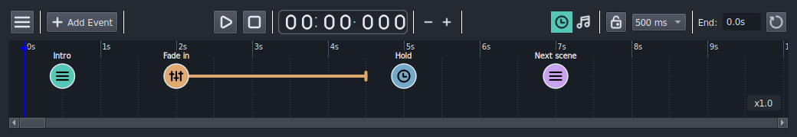
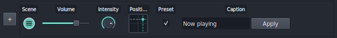
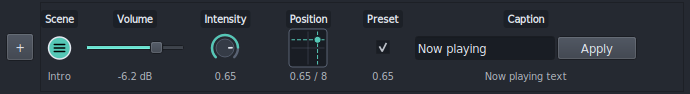

# Timeline for OBS

**Compose your stream on a timeline. Control it live with Macro Strip.**

Timeline is a native OBS Studio plugin for arranging scene changes, effects,
media and other actions into timed sequences. Its companion Macro Strip dock
lets you build a compact control surface with buttons, sliders, knobs, toggles, XY pads and
text entry.



*Current Timeline interface, captured in an isolated Qt/libobs session.*

[Installation](#installation) · [Timeline](#timeline) · [Macro Strip](#macro-strip) ·
[Shortcuts](#keyboard-shortcuts) · [Documentation](#documentation)

> [!NOTE]
> Early preview (`v0.1.0-preview.1`). Linux source builds and CI packages are
> available for testing. There is no tagged release yet. Back up your OBS
> scene collections and test before using it live.

## Timeline

Build reusable sequences without leaving OBS.

- Place, drag and edit events directly on the timeline.
- Snap to time intervals or musical beats using BPM and note subdivisions.
- Scrub, play, pause, stop, restart or loop at a defined end marker.
- Customize event colors, labels, SVG icons and durations.
- Copy, paste, delete and nudge selections; undo or redo the last 100 edits.
- Zoom, use compact mode, or scroll through stacked event lanes.
- Save automatically, import/export JSON and trigger nested timelines.

### Available actions

| Action | What it does |
| --- | --- |
| Scene Switch | Switch scenes, optionally with a named transition. |
| Source Visibility | Show or hide a scene item, including nested sources and groups. |
| Media Playback | Restart, stop, pause, resume or seek a media source. |
| Filter Visibility | Enable or disable a source filter. |
| Set Parameter Value | Set a source/filter property or ease between numeric values over time. |
| Hotkey Trigger | Run an OBS or third-party plugin hotkey. |
| Trigger Timeline | Play another saved timeline. |
| Freeze Time | Hold the timeline clock without adding empty ruler space. |
| Downstream Keyer Scene | Select or hide an overlay scene in a named keyer (optional integration). |

Visibility, filter, compatible media and Downstream Keyer actions can have a duration, with
an explicit ending state or the original inverse at the end. Numeric
parameter cues can also interpolate over a duration; seek, boolean and text
parameter cues remain instantaneous.
See [action behavior](docs/USAGE.md#action-behavior) for the details.

### Create your first sequence

1. Open **View → Docks → Timeline**.
2. Click **Add Event**, or double-click an empty part of the timeline.
3. Choose an action and its target. Set a duration if needed.
4. Drag the event to its desired time, or edit its exact timestamp.
5. Press **Play**.

### Set a parameter at a specific time

Choose **Set Parameter Value → Choose parameter and value**, then select
a source or filter, its property, and the desired value.

For example, three cues could control a HyperShaderFX filter's effect opacity:

| Time | Property | Value |
| --- | --- | ---: |
| 0 s | Effect Opacity | 0.00 |
| 2 s | Effect Opacity | 1.00 |
| 6 s | Effect Opacity | 0.25 |

Each cue applies its value when playback reaches it. The value stays set until
another cue or manual adjustment changes it. To animate a numeric property,
enable **Duration**, enter an end value and select Linear, Ease in, Ease out
or Ease in/out. The ramp follows the timeline clock, including Freeze Time.
See [parameter animation](docs/USAGE.md#animating-a-parameter).

Use **Freeze Time** to insert a wait of up to 24 hours without expanding
the ruler. All later cues follow the held timeline clock; OBS itself
continues running. See [clock holds](docs/USAGE.md#freeze-time).

## Macro Strip

Build a small control surface for your OBS setup. Open
**View → Docks → Macro Strip** and use **+** to add an action button or a
parameter control.





| Control | Example use |
| --- | --- |
| Action button | Switch scenes, run a hotkey or apply a parameter preset. |
| Slider | Adjust mixer volume, effect opacity or another numeric property. |
| Knob | Adjust shader speed or intensity. |
| Toggle | Turn a boolean on/off or switch between two defined numeric or text values. |
| Text entry | Edit a source caption or another exposed string property. |
| XY controller | Adjust two numeric properties with a single two-axis gesture. |

### Assign a live control

1. Click **+ → Parameter control**.
2. Choose Slider, Knob, Toggle or Text entry.
3. Select a source or filter, then a compatible parameter and give it a label.
4. Adjust it directly in the dock. Right-click to edit, reorder or remove it.

The parameter picker discovers compatible OBS properties dynamically, including
those exposed by third-party plugins. Controls inherit the declared range,
step and units and reflect changes made elsewhere in OBS, including scheduled
Timeline cues. Saved bindings follow source/filter identities through renames.

Knobs use a compact, themed progress arc and vertical dragging, with no
value jump on click. Captions reserve fixed space, so live values never
shift neighboring controls. Right-click **Labels and appearance** to rename
the top tag, add a bottom caption or enable a live value readout. Hold **Shift** for 10× finer movement, or focus a knob and use the wheel or arrow keys.

Use **+ → XY controller** to assign two separate numeric properties to
a compact crosshair pad (40 px by default; 48 or 64 px optional). Both values follow OBS readback, and each axis
uses its own range and step.

Audio sources also expose **Mixer / Volume** and **Mixer / Mute**. Volume
uses OBS’s logarithmic fader curve with a dB readout; both can be scheduled
with Set Parameter Value.

For non-boolean toggles, choose State A and State B in the binding editor.
The checkbox follows the actual property, using an indeterminate state for
values outside the presets. The next click from that state selects A.

Numeric, boolean and editable text properties are supported. Text entries
apply changes explicitly; multiline fields open a larger editor without
growing the dock. Password and informational fields are excluded. Color,
list controls, custom ranges and scene-item transforms are not yet supported.
See [live control details](docs/USAGE.md#live-parameter-controls).

## Installation

Choose the build matching your OBS major version. Do not mix plugin variants.

| OBS version | Availability |
| --- | --- |
| 31 | Linux, Windows and macOS builds (macOS 12+). |
| 32 | Linux, Windows and macOS builds (macOS 13+). |
| 33 | Experimental Linux compatibility target. |

Preview CI artifacts are available from [GitHub Actions](https://github.com/myrqyry/timeline/actions).
Windows and macOS runtime installation and interactive testing remain outstanding.

### Build from source (Linux)

Requirements: CMake 3.28+, C++17, Qt6 development packages, Ninja and matching
libobs development headers/libraries. Close OBS before installing.

```bash
cmake --preset ubuntu-x86_64 -DTIMELINE_OBS_COMPATIBILITY=obs32
cmake --build --preset ubuntu-x86_64
cmake --install build_x86_64
```

Use `obs31` for OBS 31 and a separate build directory when switching SDKs.
See [PACKAGING.md](PACKAGING.md) for dependencies, other targets, custom install
paths and optional WebSocket support.

Restart OBS and enable the Timeline and Macro Strip docks.

## Keyboard shortcuts

| Shortcut | Action |
| --- | --- |
| Space | Play / pause |
| Home | Seek to start |
| Delete | Delete selected events |
| Left / Right | Nudge selected events by 1 second |
| Shift + Left / Right | Nudge by 100 ms |
| Ctrl + C / V | Copy / paste events |
| Ctrl + Z | Undo |
| Ctrl + Shift + Z (platform redo) | Redo |
| Ctrl + mouse wheel | Zoom timeline |
| Shift + mouse wheel | Scroll vertically when event lanes overflow |

Use **Settings → Compact mode** to shrink the Timeline toolbar and events
together. Undo and Redo are also at the top of the Timeline menu.
History is session-only, edits event data rather than live OBS
state, and is disabled during playback.

## Compatibility and saved state

Timeline and Macro Strip save automatically to OBS's plugin configuration
directory. On Linux this is `~/.config/obs-studio/plugin_config/timeline/`.
Timeline documents can also be imported/exported as JSON.

New explicit target bindings survive renames and do not silently redirect
missing targets. Older name-based actions keep their existing behavior.
Back up saved timelines and macros before downgrading: older versions may
skip new actions or controls and discard them when saving.

Only play timeline files you trust; they can change your OBS state.

## Development status

- Native OBS32 source checkpoint `f6ae128` and its documentation harness:
  **101/101 strict Qt/libobs tests passed**, zero failures/skips.
- The matching build was installed in native OBS 32.2.0 on Linux.
  Both docks and the WebSocket vendor registered in an isolated startup;
  saved timeline and macro configuration checksums were unchanged.
- The screenshots above use the production Qt widgets with synthetic
  sources, a dark Fusion palette, English localization and headless Xvfb.
  See [capture instructions](docs/screenshots/README.md).
- HyperShaderFX effect opacity and a shader uniform have been verified
  through the real plugin's property interface. Render smoothness,
  interactive theme acceptance, and Windows/macOS runtime use remain
  unverified.
- Additional multi-selection editing, HTTP actions and release-grade
  cross-platform installers remain planned work. See the
  [release checklist](docs/RELEASE_CHECKLIST.md) for remaining gates.

## Documentation

| Guide | Contents |
| --- | --- |
| [Usage guide](docs/USAGE.md) | Detailed action behavior, live controls, hotkeys, integrations and saved state. |
| [Build and packaging](PACKAGING.md) | SDKs, dependencies, artifacts and install paths. |
| [Architecture](docs/ARCHITECTURE.md) | Runtime boundaries, event formats, scheduling and persistence. |
| [Release checklist](docs/RELEASE_CHECKLIST.md) | Verification evidence, test commands and remaining release gates. |
| [Contributor instructions](AGENTS.md) | Repository conventions and development workflow. |

## License

GPL-2.0-or-later.
