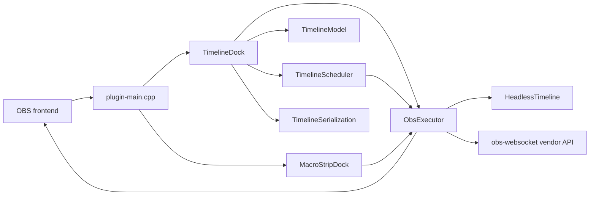

# Timeline for OBS architecture

This document is the maintainer reference for Timeline for OBS. It describes
the current implementation, the reasons for its major boundaries, the runtime
data flows, and the operational constraints that matter when extending the
plugin.

For current behavior, verify claims against executable code and configuration.
When they disagree with a maintained contract or intended design, identify the
conflict before deciding whether the prose is stale or the implementation is
defective. Do not change runtime behavior solely to match stale prose.

## Executive summary

Timeline for OBS is a Qt6 dock plugin that schedules OBS actions against a
clock-driven playhead. The plugin separates event data, time progression, OBS
dispatch, and presentation into distinct components. The same model, scheduler,
and executor concepts also run without a UI for nested timeline files.

The main runtime path is:

```text
OBS loads the module
  -> plugin-main registers Timeline and Macro Strip docks
  -> TimelineDock owns TimelineModel, TimelineScheduler, and ObsExecutor
  -> scheduler emits eventStarted/eventEnded
  -> executor performs OBS actions
  -> dock persists timeline settings through TimelineSerialization
```

The plugin is currently a source-built Linux preview. CMake declares project
version `0.1.0` from `buildspec.json` through `cmake/common/bootstrap.cmake`;
the development milestone is `v0.1.0-preview.1`, not a published tag. The module
banner reports load status but does not duplicate
the release version.

## Audience and reading paths

Different maintainers need different entry points. Use the shortest path that
matches the work you are doing.

| Audience | Start here | Then read |
| --- | --- | --- |
| New contributor | `README.md` | `AGENTS.md`, this document |
| UI contributor | `src/timeline-dock.h:29-96` | `src/timeline-dock.cpp:341-2234`, `src/timeline-event-item.cpp:16-454` |
| Scheduler or action contributor | `src/timeline-scheduler.h:9-57` | `src/timeline-scheduler.cpp:4-198`, `src/obs-executor.cpp:49-430` |
| Persistence contributor | `src/timeline-serialization.h:9-40` | `src/timeline-serialization.cpp:4-121`, `src/timeline-model.cpp:9-181` |
| Nested timeline contributor | `src/headless-timeline.h:11-48` | `src/headless-timeline.cpp:8-84`, `src/obs-executor.cpp:373-430` |
| Release maintainer | `PACKAGING.md` | `docs/RELEASE_CHECKLIST.md`, `CMakePresets.json` |
| Test contributor | `tests/AGENTS.md` | `tests/CMakeLists.txt`, `tests/main_test.cpp` |

## System boundary

The plugin runs inside the OBS frontend process. It does not own OBS’s scene,
source, transition, hotkey, or WebSocket servers. It requests operations from
those APIs and keeps only short-lived references where the API requires them.



The module entrypoint creates both docks and connects the Macro Strip to the
Timeline dock's executor. This sharing prevents the two UI surfaces from
implementing different OBS action semantics (`src/plugin-main.cpp:55-72`).

### External dependencies

The build requires CMake 3.28+, C++17, Qt6 Core/Gui/Widgets/Svg, and the OBS
libraries exposed through the official OBS plugin-template CMake targets
(`CMakeLists.txt`). Tests default to enabled and also require Qt6 Test; the
Ubuntu presets use Ninja. Select `obs31` or `obs32` with
`TIMELINE_OBS_COMPATIBILITY`; the selected target is pinned to OBS 31.1.2 or
OBS 32.2.1 in `buildspec.json`. CI can build that SDK from source with
`TIMELINE_BUILD_OBS_FROM_SOURCE=ON`. WebSocket vendor support is optional. When
`ENABLE_OBS_WEBSOCKET_VENDOR` is enabled and `obs-websocket-api.h` is found,
CMake defines `OBS_TIMELINE_HAS_WEBSOCKET=1`; otherwise it compiles the
integration out (`CMakeLists.txt`, **Optional obs-websocket vendor integration**).

## Module map

Each module has one primary responsibility. The boundaries are deliberately
simple because the plugin runs in a host process where UI lifetime, OBS object
lifetime, and callback teardown must remain easy to trace.

| Module | Responsibility | Primary boundary |
| --- | --- | --- |
| `plugin-main.cpp` | OBS module registration, dock registration, module callbacks, Macro Strip persistence | OBS frontend API |
| `timeline-dock.cpp/.h` | Main timeline UI, editing, playhead, ruler, grid, import/export | Qt widgets and graphics scene |
| `timeline-model.cpp/.h` | Sorted event records and model mutation signals | Plain `TimelineEvent` data |
| `timeline-scheduler.cpp/.h` | Playhead clock, start/end detection, looping, finish signals | `TimelineModel` in, Qt signals out |
| `obs-executor.cpp/.h` | Translate timeline actions into OBS API calls | OBS frontend/libobs APIs |
| `headless-timeline.cpp/.h` | Run a nested timeline without a dock | Model + scheduler + executor |
| `timeline-serialization.cpp/.h` | Timeline JSON document format and atomic file I/O | `QJsonDocument`, `QSaveFile` (writes), `QFile` (reads) |
| `timeline-event-item.cpp/.h` | Render and drag one event bubble | `QGraphicsEllipseItem` |
| `event-editor.cpp/.h` | Modal event creation/editing and OBS target discovery | Qt dialog and OBS enumeration |
| `macro-strip-dock.cpp/.h` | Macro action and parameter-control UI, separate persistence | `MacroButtonModel`, shared executor, parameter bindings |
| `macro-parameter.cpp/.h` | Source/filter identity, live property discovery, typed read/write | libobs source/property/settings API |
| `macro-parameter-widget.cpp/.h` | Parameter editor and live slider/knob/toggle | Qt Widgets, MacroParameter |
| `macro-serialization.cpp/.h` | Macro button JSON format and atomic file I/O | `QJsonDocument`, `QSaveFile` (writes), `QFile` (reads) |
| `theme-helpers.h` | Theme-aware SVG paths and default colors | Qt palette and OBS theme widgets |
| `timecode-display.cpp/.h` | Theme-aware playback clock | Qt custom widget |

The source list is maintained manually in `CMakeLists.txt`. Adding a new
`.cpp` file requires adding it to `PLUGIN_SOURCES`; adding a header to
`PLUGIN_HEADERS` keeps it visible to the target and IDEs.

## Module lifecycle

OBS calls the module entrypoints defined in `plugin-main.cpp`. The lifecycle is
important because frontend callbacks and Qt objects must be unregistered before
their targets are destroyed.

### Load

`obs_module_load()` logs startup, creates `TimelineDock`, registers it as the
`timeline_dock` dock, creates `MacroStripDock`, registers it as
`timeline_macro_strip`, and gives Macro Strip the Timeline dock's executor
(`src/plugin-main.cpp:54-78`). `TimelineDock` constructs its model, scheduler,
executor, UI, callbacks, hotkeys, and initial configuration in that order
(`src/timeline-dock.cpp:49-96`).

### Post-load

`obs_module_post_load()` registers the optional `timeline` WebSocket vendor and
passes the vendor handle into the Timeline dock. It then loads Macro Strip data
after the dock exists (`src/plugin-main.cpp:105-125`).

### Unload

`obs_module_unload()` unregisters the Macro Strip frontend and save callbacks,
saves the Macro Strip, removes both docks, and schedules both widgets for Qt
destruction (`src/plugin-main.cpp:81-103`). `TimelineDock::~TimelineDock()` saves
the timeline, removes its frontend callbacks, unregisters its hotkeys, and clears
scene-owned ruler objects (`src/timeline-dock.cpp:98-112`).

### Frontend events

TimelineDock handles theme changes, scene collection changes, finished loading,
and OBS exit through `frontendEventCallback`. Qt work is queued back to the dock
thread. Both docks refresh palette-dependent graphics and geometry in place
on frontend theme changes and queued Qt palette/style/font changes. The
Timeline invalidates ruler/grid caches and recolors markers and handles.
Macro Strip retains existing controls, pending text drafts and gestures;
a theme refresh does not schedule a model save. Native inputs inherit
OBS/Qt styling. IconaMoon toolbar colors use the paired palette role,
including valid dark foregrounds on light themes. Intentional event colors
and custom SVG artwork remain independent of the theme.

## Core data model

### TimelineEvent

`TimelineEvent` is the value object passed between the editor, model, scheduler,
executor, serialization layer, and tests (`src/event-types.h:21-36`). Its UUID is
generated during default construction.

| Field | Meaning |
| --- | --- |
| `id` | Stable UUID used by the model and graphics-item map |
| `timeMs` | Start position in milliseconds |
| `type` | One of the exposed or reserved `TimelineEventType` values |
| `sourceName` | Scene, source, hotkey, or fallback timeline name |
| `filterName` | Filter target for filter events |
| `data` | Type-specific QVariant payload, such as transition or file path |
| `color` | Bubble color, defaulting to cyan before type defaults are applied |
| `customIconPath` | Optional user-supplied SVG path |
| `label` | Optional event label |
| `showLabel` | Whether the label is rendered |
| `hasDuration` | Whether the scheduler emits an end event |
| `durationMs` | Duration in milliseconds |

The enum contains sixteen values, with IDs preserved and new operations
appended. Historical `MediaSeek` (ID 3) is reserved; the shared editor
groups the five current media actions under Media Playback.

### Event semantics

The executor interprets duration and instant events differently:

| Type | Start action | Default end action when duration is enabled |
| --- | --- | --- |
| `SourceShow` | Make source visible | Hide source |
| `SourceHide` | Hide source | Make source visible |
| `MediaStart` | Restart media | Stop media |
| `MediaStop` | Stop media | Restart media |
| `MediaPause` | Pause media | Resume media |
| `MediaResume` | Resume media | Pause media |
| `MediaSeekTo` | Seek to absolute media position | No end action |
| `SetParameterValue` | Set a typed source/filter property to a defined value | No end action |
| `FreezeTime` | Scheduler holds logical time | No end action |
| `FilterEnable` | Enable filter | Disable filter |
| `FilterDisable` | Disable filter | Enable filter |
| `SceneSwitch` | Switch scene | No end action |
| `HotkeyTrigger` | Trigger named hotkey | No end action |
| `TriggerTimeline` | Start nested file | No end action |
| `DownstreamKeyerScene` | Select or hide named keyer scene | Hide overlay |

New media actions use appended IDs 11–13; historical ID 3
(`MediaSeek`) remains reserved and does not execute. The common editor
discovers sources with `OBS_SOURCE_CONTROLLABLE_MEDIA` across the current
scene and the collection, including groups and nested scenes, deduplicated
by UUID. Media data is a string `media:v1:<source UUID>:<position ms>`
to work with existing Timeline and Macro Strip persistence. A blank UUID
denotes a deliberately name-based legacy target. Malformed explicit
targets and missing UUIDs do not fall back. Seek requires the versioned
data and dispatches only at the start; duration is disabled in its editor.

Optional duration fields `endAction` and `endScene` specify an explicit
ending operation. Empty/absent endAction retains the historical default;
keep is a no-op. Visibility, filter, media and DSK endings are restricted
to the original action family and preserve its target data. For DSK,
select-overlay uses the ending scene on the original keyer/view. Unknown
or incompatible explicit actions skip execution. The executor maps
explicit ends to the normal start-action path, so target validation is
shared. Both fields participate in model equality/history and JSON.
This does not capture or restore arbitrary live prior state.

The mapping is implemented in `ObsExecutor::performAction()`
(`src/obs-executor.cpp:110-162`).

For new SourceShow/SourceHide actions, the shared EventEditor stores a
`scene-item:v1:<owner UUID>:<item ID>:<source UUID>` string in the existing
`data` field (including Macro Strip JSON). The owner may be a scene or group.
The picker traverses nested scenes and groups once per underlying container.
The executor resolves the owner UUID and item ID and verifies the referenced
source UUID before changing the item's own visibility. It does not change
parent visibility or fall back to a different item for invalid explicit keys.
Legacy name-based actions retain their original lookup semantics. Do not run
new exact-target actions in older plugin builds that ignore this data.

### TimelineModel

`TimelineModel` owns a `std::vector<TimelineEvent>`. Successful edit
transactions and JSON loads emit `modelChanged()`; mutations that change time
or insert events maintain ascending `timeMs` order with stable ordering for
equal times. Batch add/remove/time updates publish a single change.

The model does not know about graphics items or OBS objects. Consumers retrieve
a const event vector, mutate through model methods, and react to
`modelChanged()`. This keeps event identity and ordering in one place.

The dock opts into session-only edit history; headless models do not retain
history. Each changed transaction retains a complete previous value-vector
(up to 100 steps), not a JSON reconstruction, so event IDs, precise times,
payloads, alpha colors and other fields survive undo/redo. No-op transactions
do not invalidate redo; successful document loads clear both history stacks.
Undo/redo restore model data and emit normal change notifications; no OBS
actions are dispatched by the history mechanism. The dock disables history
actions while playing, loading, or dragging. Settings and playhead state
remain outside event history. History is not serialized.

### MacroButton

`MacroButton` is a strip record with stable ID, label and a control kind.
Legacy action records retain event type, target, optional filter, serialized
string data and color. Clicking an action creates a temporary
`TimelineEvent` and calls the shared executor immediately. Parameter records
instead bind an OBS source UUID, optional attached filter UUID, property key
and scalar type. They never dispatch a timeline action.

The same binding catalog and typed write path are used by the
`SetParameterValue` timeline event (appended enum ID 14). Its string data
contains a versioned JSON object with source/filter UUID, key, scalar type,
and typed value (numeric, boolean as 0/1, or string for text). The event editor reuses the dynamic
binding dialog, replacing control kind with a numeric, On/Off or text value editor.
The executor validates the payload and live property and applies it at event
start for version-1 instant cues. Version-2 numeric payloads add endValue
and easing; duration is stored on the event. No writes occur on editor
acceptance. A Macro Strip action button can use the version-1 event payload.
Existing live parameter widgets read the resulting OBS value normally.

The target catalog traverses scene/group sources and enumerates standalone
sources and their filters. Bindings resolve by UUID only; private filters are
resolved through their owner. Property discovery walks visible, enabled
numeric/boolean/text properties recursively, honoring checkable groups. Dedicated
action adapters are not required for standard scalar properties.
The parameter editor reads the current property description, range, step and
suffix; missing saved keys require explicit reassignment. The editor refreshes the live
target catalog and selected target schema at one-second intervals, comparing
records before changing combo box contents. It retains valid UUID/key/type
selections and the chosen control kind, clears invalid choices, and defers
refresh while a dropdown popup is open (or the numeric defined-value field
has focus). Final acceptance revalidates the
binding against the current property schema.

Native Qt slider/dial/check box controls read current OBS settings without
writing at startup. The dial retains QDial behavior and accessibility but custom-paints a
32-pixel arc and face using palette roles (including disabled colors). It
uses relative vertical mouse movement with a fractional accumulator, saturates at range endpoints,
and scales drag motion by 0.1 with Shift. Successful coalesced writes do not
read back into controls during an active drag; final release resumes normal
readback. Focused wheel and arrow events adjust individual steps. Visible
widgets poll values every 250 ms, refresh the
property schema approximately every two seconds, and block UI signals during
readback. Continuous writes are coalesced at 80 ms intervals, with an immediate
final write on slider release; boolean toggles write immediately. Each write
checks the current property schema, quantizes to its current step and sends
a typed one-key settings patch via `obs_source_update`. The live source owns
the value. Parameter adjustments do not modify macro configuration/history.
Unavailable targets disable interaction. Schema refresh and update callbacks
run on the dock thread; performance depends on the target plugin's property
and update implementation.

### Text bindings

Text controls use a distinct scalar type and control kind, serialized as
`text`. Only enabled, visible OBS_TEXT_DEFAULT and OBS_TEXT_MULTILINE
properties qualify; password and informational properties are excluded.
The text read/write path validates the live schema and avoids numeric
conversion. String values use UTF-8 OBS settings updates and versioned
JSON cue payloads; embedded NUL is rejected. The single-line control
preserves a local draft until Apply (or the native returnPressed signal),
and external readback updates only clean entries. Multiline editing uses
a modal dialog to preserve the strip's two-row layout; committed values
are not stored in the macro configuration. Older versions do not
understand text bindings and may reject macro documents containing them;
back up configurations before downgrading.

### Native mixer binding domain

The optional binding domain distinguishes OBS settings properties (absent
or empty) from native mixer controls (`mixer`). Native keys are
`timeline:mixer:volume` and `timeline:mixer:mute`. The catalog adds these
only to audio-capable non-filter sources. Both saved controls and defined
value payloads retain the domain. The resolver validates the source UUID,
domain, key, scalar type and audio capability; mixer operations do not
enumerate the source's plugin-property schema.

Volume converts normalized fader position (0–100%, step 0.1%) through
a scoped libobs `OBS_FADER_LOG` conversion object and uses
`obs_source_get_volume` / `obs_source_set_volume` for read/write.
Mute calls the native mute APIs independently. No attached fader or extra
source reference persists after the operation. Existing coalescing and
readback apply to these bindings; labels display the corresponding dB.
The range ends at unity and does not represent above-unity gain.
Older builds do not understand this domain; keep backups before downgrade.

## Scheduler architecture

The scheduler owns playback time, not OBS behavior. It uses a Qt timer with an
8 ms target interval, approximately 125 Hz, to reduce timing quantization for
fine BPM subdivisions (`src/timeline-scheduler.cpp:4-9`,
`src/timeline-scheduler.h:56`).

### Clock model

`currentOffsetMs` stores the paused or stopped playhead position. `startTime`
stores the `std::chrono::steady_clock` reference captured when playback
resumes. While playing, `getCurrentTime()` returns `currentOffsetMs` plus
elapsed monotonic time, independently of wall-clock adjustments.

This design means pause and resume preserve the playhead without accumulating
timer drift. `stop()` preserves the current position; `restart()` stops the
timer and seeks to zero (`src/timeline-scheduler.cpp:54-78`).

FreezeTime (ID 15) stores a bounded positive real-time wait in event
data (milliseconds), not a duration span. Before dispatching due cues,
the scheduler clamps the tick to the earliest unfired hold, sums waits
at that timestamp and starts a monotonic countdown. The start cursor and
end scan cannot run beyond that timestamp until the wait expires. Manual
pause retains the remaining wait; seeking resets it. A late tick begins
the full wait when the marker is actually processed. Loop/end completion
waits for the hold at the boundary. The executor does not alter OBS state
for this cue. Macro Strip excludes the scheduler-only type.

### Parameter animation

A version-2 SetParameterValue payload contains the version-1 binding/start
value plus numeric endValue and a stable easing name. The scheduler tracks
active ramps by source/filter UUID, domain and property key. A new valid
parameter cue on that binding replaces the previous ramp. At each due
cue boundary and at the current logical tick, the scheduler samples active
ramps and emits parameterProgress. Completion samples use progress 1;
old superseded endpoints do not write. Start actions apply progress 0.
The executor evaluates the selected linear or quadratic easing curve and
uses the existing validated, range-quantized parameter writer, skipping
unchanged intermediate values. No independent animation timer or persistent
OBS source reference is needed. Freeze Time and pause naturally suspend
samples. Seek/model changes rebuild active ramps from fired cues without
performing writes on scrubbing; loop clears active ramps.

Per-scheduler ownership is intentional: independent timelines and live
controls may still target the same property. Real source update cost and
render smoothness depend on each plugin and have not been benchmarked.

### Start and end detection

The model is sorted by start time, so the scheduler maintains
`nextStartIndex`. Each tick advances that cursor only through events whose
start time has arrived. Duration end times are not sorted by start time, so
the scheduler retains a separate scan for end events. Due start and end cues
are copied into a small batch, ordered by cue timestamp, and dispatched in
that order. At equal timestamps, duration ends precede new starts. A delayed
tick can recover cue ordering, but cannot recreate time that has already elapsed.

`eventStartFired` and `eventEndFired` prevent repeated signals across timer
ticks. Seeking clears both sets and marks events strictly before the new
position as already fired. Model changes rebuild the sets from scratch, marking
events strictly behind the playhead as fired. This allows events relocated
ahead of the playhead to fire again naturally
(`src/timeline-scheduler.cpp:11-39`, `src/timeline-scheduler.cpp:98-128`).

### End time and looping

When `endTimeMs` is positive and the current time reaches it, the scheduler
first drains all outstanding cues through the end marker, inclusive. It never
dispatches cues beyond that marker. Non-loop playback stops exactly at the
marker and emits its final tick before `finished()`. Loop playback completes
the outgoing cycle before a tick at zero, `looped()`, and the next cycle’s
zero-time cues. As before, a loop restarts at zero rather than recovering
multiple missed cycles. Durations extending beyond an explicit end marker
are not implicitly shortened or cleaned up.

### Scheduler signals

| Signal | Consumer | Meaning |
| --- | --- | --- |
| `tick(double)` | `TimelineDock` | Refresh playhead and time display |
| `eventStarted(TimelineEvent)` | `ObsExecutor` | Execute start action |
| `eventEnded(TimelineEvent)` | `ObsExecutor` | Execute duration end action |
| `finished()` | `TimelineDock` | Update playback UI after end time |
| `looped()` | `TimelineDock` | Persist or refresh loop state |

The Timeline dock connects these signals during construction
(`src/timeline-dock.cpp:59-63`). Headless timelines make the same scheduler to
executor connections without a UI (`src/headless-timeline.cpp:8-21`).

## OBS executor

`ObsExecutor` is the only component that translates timeline actions into OBS
frontend or libobs calls. It does not own the event model or determine when an
event fires.

### Scene switching and transitions

For a named transition, the executor finds the matching OBS source, caches the
original frontend transition, applies the requested transition, and switches
the scene (`src/obs-executor.cpp:189-227`). A single `restoreTimer` replaces
any pending restoration, preventing overlapping timers from restoring the wrong
transition during rapid consecutive switches. The timer uses the frontend
transition duration, with a 300 ms fallback when OBS reports a non-positive
duration. Source references are released by `restoreOriginalTransition()` or
`cancelRestoreTimer()` (`src/obs-executor.cpp:10-50`).

The executor uses `obs_frontend_source_list_free()` after transition
enumeration. `find_transition()` adds a reference to the selected source before
freeing the list (`src/obs-executor.cpp:160-187`). This reference pattern is
required whenever a source survives the list lifetime.

### Source visibility

Explicit scene-item targets resolve the owner UUID, item ID and source UUID
through `SceneItemTarget::setVisible()`. Missing or invalid identities do not
fall back. Legacy name-based actions check the current scene first, then
enumerate frontend scenes and stop at the first matching item. The fallback
search can be expensive in large scene collections.

### Media, filters and properties

Media actions use `MediaTarget` for explicit UUID or legacy name resolution,
then call restart, stop, play/pause, or set-time via libobs. Seek clamps to
known positive media duration. Filter enable/disable still resolves a named
source and filter. Missing targets produce warnings rather than terminating
playback.

`SetParameterValue` decodes its versioned payload and calls
`MacroParameter::write()` on start only. Live controls use that same validated
typed patch path without going through the scheduler or executor. OBS owns
the settings; the target plugin owns the result of applying them.

### Hotkeys

New hotkey events use a versioned string payload in event data, with the
registerer category, owner identity and registered internal name.
Source owners use UUIDs; outputs, encoders and services use internal
object names; frontend registrations have no owner. The shared catalog
resolves a unique match at execution without relying on transient numeric
hotkey IDs. Missing or duplicate explicit identities fail closed.
Legacy events without this payload retain first-name-match execution.
Both Timeline and Macro Strip use the same editor and resolver.

Hotkey execution enumerates registered hotkeys, stores the matching ID, stops
enumeration, and only then triggers the routed callback twice for press and
release (`src/obs-executor.cpp:336-371`). Collecting the ID first avoids
mutating the hotkey table while it is being enumerated.

### WebSocket vendor events

When compiled with WebSocket support and given a vendor handle, the executor
emits `TimelineEvent` notifications on event start and end. The payload contains
the event phase, numeric type, source name, and start time; it does not serialize
the complete QVariant payload (`src/obs-executor.cpp:75-88`). Playback status
notifications are emitted by the dock for started, paused, stopped, and finished
states (`src/timeline-dock.cpp:1259-1308`). Authentication and transport access
remain responsibilities of OBS WebSocket.

### Nested timelines

`TriggerTimeline` resolves its file path from `evt.data`, falling back to
`sourceName` for older records. It canonicalizes the path and rejects a request
whose path is already in the inherited ancestor chain or among this executor's
active children (`ObsExecutor::handleTriggerTimeline()` in `src/obs-executor.cpp`). A successful
request creates a child `HeadlessTimeline`, passes on its ancestry, stores it in
`activeTimelines`, connects its finish signal, and starts it
(`src/obs-executor.cpp:422-445`).

`cancelAll()` stops active children and schedules them for deletion before
restoring its own pending temporary transition. This unwinds nested transition
overrides child-first (`src/obs-executor.cpp:58-79`). The child owns its model, scheduler, and executor
through Qt parent ownership (`src/headless-timeline.cpp:8-21`).

Headless loading accepts event arrays and object documents directly, without
using `TimelineSerialization::fromJsonDocument()`. It reads only loop and end
settings; `endTime` is in seconds and is converted to scheduler milliseconds.
When no positive end time is supplied, it uses the latest event end plus 100 ms,
or 100 ms for an empty timeline (`HeadlessTimeline::loadFromFile()`).

## Timeline dock and UI pipeline

`TimelineDock` is the composition root for the timeline UI. It owns the model,
scheduler, executor, graphics view, scene, controls, and event-item map
(`src/timeline-dock.h`). Its large surface area is intentional for the
current plugin, but all persistent event changes still pass through the model.

### Construction and persistence

Construction creates the core objects, registers Qt metatypes, builds the UI,
connects scheduler signals, installs a 250 ms save debounce timer, registers OBS
callbacks and hotkeys, then loads the module configuration
(`src/timeline-dock.cpp:49-97`).

The automatic timeline file is obtained through
`obs_module_get_config_path(..., "timeline.json")`, not the plugin install data
directory (`src/timeline-dock.cpp:221-304`). Manual Save and Load use a file
dialog and the same JSON document format (`src/timeline-dock.cpp:1373-1431`).

### Model-to-view synchronization

`modelChanged()` schedules one queued `rebuildEventItems()` call while no rebuild
is pending. This coalesces rapid changes; paste, delete and nudge are single model transactions
(`src/timeline-dock.cpp:69-77`). During an event drag, rebuilds are deferred and
re-scheduled on mouse release (`src/timeline-dock.cpp:1231-1253`).

`rebuildEventItems()` sorts indices by event time, assigns stack lanes, creates
or updates `TimelineEventItem` objects keyed by event ID, removes stale items,
and updates labels and tooltips (`src/timeline-dock.cpp:1876-2057`). The map is
keyed by UUID so multiple events at the same time remain distinct.

### Timeline interaction

The viewport event filter implements:

- Context-menu event insertion at a clicked time.
- Control-wheel stepped zoom.
- Horizontal wheel scrolling, with Shift-wheel scrolling additional lanes
  vertically when needed.
- Playhead scrubbing.
- End-marker dragging.
- Hover time display.

These paths are implemented in `src/timeline-dock.cpp:1067-1257`. Event items
handle their own drag, hover, selection, edit, color, and delete signals
(`src/timeline-event-item.cpp:165-225`). The dock converts those signals into
model mutations in `src/timeline-dock.cpp:1830-1872`.

### Compact layout and viewport bounds

Compact mode updates toolbar icon sizes, timecode, marker dimensions and
stacking together, on toggle and document load. Zoom also recomputes lanes
while preserving item identity and exact timestamps. The minimum graphics
viewport reserves the ruler, one complete event bubble and decoration, plus
horizontal scrollbar/frame space. Scene height is the larger of the viewport
and event content height; additional lanes become vertically scrollable
instead of imposing an unbounded minimum dock height. The ruler currently
scrolls with the scene. Playhead, grid and end marker use the scene height.

Macro Strip uses shared caption and control rows derived from caption font
metrics, native slider/toggle/text-entry/button size hints and the fixed dial size. The inner
scroll area reserves horizontal scrollbar space; the outer dock remains
resizable. Rows recalculate on model rebuild and frontend theme changes.
Live parameter columns reserve width from the assigned caption, control
kind and native control minimums, independently of current values or schema
availability. StableCaption preserves its full QLabel text while painting
a middle-elided line inside the reserved width.

### Grid, snapping, and BPM

Time mode uses the selected manual interval. BPM mode computes the interval as
`(60 / bpm) * noteLengthBeats * 1000`, which is shared by grid rendering,
placement, and item snapping (`src/timeline-dock.cpp:1346-1362`). The editor and
context menu placement flow snap the requested time before creating the event
(`src/timeline-dock.cpp:1802-1835`).

### Graphics item lifecycle

`TimelineEventItem` combines `QObject` signals with `QGraphicsEllipseItem`
rendering. It keeps its time centered under zoom changes, constrains movement to
the timeline bounds, and draws duration lines, icons, selection rings, hover
glows, and optional labels (`src/timeline-event-item.cpp:16-75`,
`src/timeline-event-item.cpp:227-343`, `src/timeline-event-item.cpp:403-454`).

The item owns a `QSvgRenderer` and synchronously replaces it when the event type,
color, or custom icon changes (`src/timeline-event-item.cpp:122-135`). Do not
change this to `deleteLater()` without re-evaluating rapid rebuild behavior.

### Keyboard shortcuts

The dock registers Space, Delete, Home, copy, paste, and native Undo/Redo
shortcuts. Undo/Redo is scoped to dock children and disabled for playback
and active drags; history edits never execute OBS actions. Space uses
`WidgetWithChildrenShortcut` but ignores activation while a line edit or combo
box has focus (`src/timeline-dock.cpp:683-696`). Left and Right nudge selected
events by one second; Shift reduces the nudge to 100 ms
(`src/timeline-dock.cpp:1471-1499`). OBS hotkey callbacks always queue Qt work
back to the dock (`src/timeline-dock.cpp:129-151`).

## Persistence and file formats

### Timeline JSON

The current timeline format is a root object with `events` and `settings`.
`TimelineSerialization::toJsonObject()` writes the complete settings set
(`src/timeline-serialization.cpp:4-29`).

```json
{
  "events": [
    {
      "id": "uuid",
      "time": 1500,
      "type": 0,
      "source": "Scene 1",
      "color": "#4a90e2",
      "data": "Fade"
    }
  ],
  "settings": {
    "loop": false,
    "endTime": 0,
    "snap": false,
    "snapIntervalMs": 500,
    "bpm": 120,
    "gridToBpm": false,
    "noteLengthBeats": 1,
    "centerControls": false,
    "alternatingBg": false,
    "compactMode": false,
    "showEndTimeOnDock": true,
    "currentTimeMs": 0,
    "zoomPixelsPerSecond": 100
  }
}
```

Bare JSON arrays remain accepted as legacy event-only files. Object documents
use defaults for omitted settings, while invalid root types and malformed files
return an error string (`src/timeline-serialization.cpp:31-68`,
`src/timeline-serialization.cpp:106-126`). Object documents require an `events`
array. Event `time`/`duration` and settings `currentTimeMs` are milliseconds;
settings `endTime` is in seconds.

Timeline saves are atomic through `QSaveFile`, which writes to a temporary
location and commits atomically on `QSaveFile::commit()`, preserving the
original file intact on any failure
(`src/timeline-serialization.cpp:71-98`). The same pattern is used for Macro
Strip data (`src/macro-serialization.cpp:80-101`).

### Timeline event serialization

`TimelineModel::toJson()` omits optional fields when they are at their defaults.
`fromJson()` generates IDs for legacy events without IDs, validates the enum
range, supports legacy `target` fields, and restores colors, labels, duration,
and type-specific data (`src/timeline-model.cpp:75-174`).

### Macro Strip JSON

Macro data uses an object with `buttons` and `version`. Each button stores its
ID, label, type, source, optional filter, optional data, and color.
Parameter records also store `control` and `binding` (sourceUuid, filterUuid,
key, type), and use the reserved invalid numeric event type -1 so old builds
cannot execute them as actions. Invalid/unknown parameter records reject the
document without replacing the current model. Legacy invalid event types
are skipped; duplicate or missing IDs are regenerated. Macro Strip loading attempts to rename files
that cannot be opened or parsed with a `.broken-<timestamp>` suffix; valid JSON
with an invalid document shape is rejected without that rename. Macro Strip stores the
current file in the writable OBS plugin configuration directory; if absent,
it migrates a valid legacy file without deleting that source. OBS scene-collection
copies are validated recovery fallbacks; a newer canonical file or pending
in-memory edits take precedence.
(`src/macro-serialization.cpp`, `src/macro-strip-dock.cpp`).

### Storage locations

| Data | Path or API | Owner |
| --- | --- | --- |
| Installed binary | `${TIMELINE_PLUGIN_ROOT}/bin/64bit/timeline.so` on Linux | CMake install (`CMakeLists.txt:122-129`) |
| Installed plugin data | `${TIMELINE_PLUGIN_ROOT}/data/` | CMake install (`CMakeLists.txt:127-129`) |
| Timeline settings | `obs_module_get_config_path(..., "timeline.json")` | OBS module config API (`src/timeline-dock.cpp:222-304`) |
| Macro buttons | `obs_module_config_path("macro_buttons.json")` | Macro Strip (`src/plugin-main.cpp`, `src/macro-strip-dock.cpp`) |
| Manual timeline export | User-selected JSON path | Timeline dock (`src/timeline-dock.cpp:1373-1395`) |

## Threading and ownership

The plugin has no custom worker thread. Qt widgets, models, schedulers, and
executors run on the owning Qt thread. The scheduler timer and its signal chain
therefore execute in that thread (`src/timeline-scheduler.cpp:4-10`,
`src/timeline-dock.cpp:60-64`).

### OBS callbacks

OBS hotkey callbacks can arrive outside the Qt UI thread. The static callbacks
do not touch widgets directly; they queue the corresponding dock slot
(`src/timeline-dock.cpp:129-151`). Frontend callbacks also queue UI work for
theme, collection, loading, and exit events (`src/timeline-dock.cpp:153-211`).

### Qt ownership

The dock parents its model, scheduler, executor, scene, controls, and timers.
Headless timelines parent their model, scheduler, and executor to the headless
controller (`src/timeline-dock.cpp:49-54`, `src/headless-timeline.cpp:8-14`).
Nested timelines are removed from the active list and scheduled for deletion
after finishing (`src/obs-executor.cpp:403-415`).

### OBS source references

Every source returned by `obs_get_source_by_name()` or frontend getters is
released after use. Sources selected from frontend lists receive an additional
reference before the list is freed when the operation outlives the list
(`src/obs-executor.cpp:143-165`, `src/obs-executor.cpp:173-224`). Any future
deferred OBS operation must document and retain its references explicitly.

## Failure modes and recovery

The plugin favors warnings and safe no-ops over terminating the OBS process.

| Failure | Current behavior | Evidence |
| --- | --- | --- |
| Timeline file missing | Create a default document directory/file | `src/timeline-dock.cpp:284-296` |
| Timeline JSON malformed | Log a warning and leave the current load operation | `src/timeline-dock.cpp:264-272`, `src/timeline-serialization.cpp:106-121` |
| Scene/source/filter missing | Log a warning; continue scheduler operation | `src/obs-executor.cpp:221-334` |
| Transition name missing | Log a warning and use the normal scene switch path | `src/obs-executor.cpp:201-204` |
| Nested file missing or invalid | Schedule child deletion and log a warning | `src/obs-executor.cpp:407-427` |
| Nested recursion | Reject canonical paths in inherited ancestry or active children | `ObsExecutor::handleTriggerTimeline()` |
| Macro file unreadable or JSON malformed | Attempt rename to a timestamped `.broken-*` file; return failure | `MacroStripDock::loadNow()` |
| Macro document shape invalid | Reject without replacing in-memory buttons or renaming the file | `MacroStripDock::loadNow()`, `MacroSerialization::fromJsonDocument()` |
| OBS exit during queued UI work | Queued work uses QObject context and teardown unregisters callbacks | `src/timeline-dock.cpp:98-112`, `src/timeline-dock.cpp:153-211` |

Persistence uses `QSaveFile`, which guarantees atomic commits on all supported
platforms. If the write or finalization fails, the original file is left
unharmed.

## Security and data protection

Timeline for OBS does not implement accounts, authentication, authorization, or
network listeners. The optional WebSocket integration registers a vendor with
OBS WebSocket; access control remains in OBS WebSocket rather than this plugin
(`src/plugin-main.cpp:106-121`, `src/obs-executor.cpp:53-87`).

The plugin reads and writes local JSON files. Timeline paths can be selected in
the event editor and nested timeline paths are opened directly by Qt
(`src/event-editor.cpp:60-76`, `src/headless-timeline.cpp:35-70`). Treat imported
timeline files as trusted local configuration: they can cause OBS scene,
source, filter, media, property-setting, and hotkey operations when played.

The plugin does not execute shell commands or interpret JSON as code. It passes
event fields to OBS APIs and Qt file APIs. A future network or command event
must define validation, authorization, and disclosure rules before implementation.

## Performance characteristics

The scheduler uses an 8 ms timer and a monotonic start cursor. Start detection
advances through each event once per forward pass; duration end detection remains
O(n) per tick because end times are not ordered by start time. Only due cues
are copied and sorted. This is appropriate for the expected
small-to-medium timeline sizes, but duration-heavy timelines remain the first
candidate for profiling.

The dock avoids unnecessary graphics work in three ways:

- `modelChanged()` coalesces rebuilds through a queued invocation
  (`src/timeline-dock.cpp:69-77`).
- Ruler and grid caches skip redraws when their relevant dimensions and settings
  are unchanged (`src/timeline-dock.cpp:994-1006`, `src/timeline-dock.cpp:1629-1650`).
- Playhead and end-marker pixmaps are cached by color
  (`src/timeline-dock.h:196-200`, `src/timeline-dock.cpp:1735-1770`).

Potentially expensive operations include scene-wide source visibility fallback
search (`src/obs-executor.cpp:287-297`), OBS target enumeration in the editor
(`src/event-editor.cpp:193-355`), and full event-item rebuilds after model
changes (`src/timeline-dock.cpp:1874-2050`). None runs in an OBS graphics
render callback.

## Deployment architecture

The plugin builds as a CMake `MODULE` named `timeline` with no `lib` prefix and
links Qt6 and OBS libraries (`CMakeLists.txt`). On Linux and Windows, CMake
installs the module and runtime `data/` assets under the configured plugin root,
excluding `AGENTS.md`. macOS uses a `.plugin` bundle with runtime assets in
`Contents/Resources` through `set_target_properties_plugin()`.

The default Linux workflow uses Ninja, RelWithDebInfo, and CTest
(`.github/workflows/linux-build.yml`). The repository also defines CMake
presets for Ubuntu, macOS, and Windows
(`CMakePresets.json:1-117`, `PACKAGING.md`). The `ubuntu-ci-x86_64` preset
adds ccache and warnings-as-errors for CI builds.

### Build switches

| Switch | Default | Effect |
| --- | --- | --- |
| `CMAKE_CXX_STANDARD` | `17` (set in `CMakeLists.txt`) | Required language standard |
| `TIMELINE_OBS_COMPATIBILITY` | `obs32` | Select `obs31` or `obs32` and the corresponding SDK target (`cmake/common/bootstrap.cmake`) |
| `TIMELINE_BUILD_OBS_FROM_SOURCE` | `OFF` | Build the pinned OBS SDK on Linux instead of using the installed SDK |
| `TIMELINE_BUILD_TESTS` | `ON` | Build the Qt Test suite; requires Qt6 Test |
| `ENABLE_OBS_WEBSOCKET_VENDOR` | `ON` | Attempt optional vendor-header integration (`CMakeLists.txt`) |
| `TIMELINE_PLUGIN_ROOT` | `$HOME/.config/obs-studio/plugins/timeline` on Linux; `$APPDATA/obs-studio/plugins/timeline` on Windows | Root for installed binary and data; macOS uses bundle rules |
| `OBS_PLUGIN_DESTINATION` | `${TIMELINE_PLUGIN_ROOT}/bin/64bit` | Installed module directory on Linux/Windows |
| `OBS_DATA_DESTINATION` | `${TIMELINE_PLUGIN_ROOT}/data` | Installed runtime data directory on Linux/Windows |

Additional preset options are available in `CMakePresets.json`. The test target
compiles the executor, headless timeline, scheduler, model, event item,
serialization, macro, and editor sources with mocked frontend and WebSocket
functions (`tests/CMakeLists.txt`).

## Testing strategy

Tests run through Qt Test with an OpenGL context and OBS startup
(`tests/main_test.cpp`). Local headless runs can skip initialization if the
runtime is unavailable. The Linux CI job runs in Xvfb with software OpenGL
and sets `TIMELINE_REQUIRE_OBS_RUNTIME=1`, which turns unavailable OBS/OpenGL
into a **failure** rather than silently skipping the suite. The suite covers
executor dispatch, model operations, scheduler signals and loops, serialization,
graphics-item behavior, Macro Strip behavior, and dock layout checks
(`tests/main_test.cpp`). The cleanup assertion requires fewer than four
residual OBS internal allocations after shutdown (`tests/main_test.cpp`).

Run the full suite from a configured build:

```bash
cmake --build --preset ubuntu-x86_64
TIMELINE_REQUIRE_OBS_RUNTIME=1 QT_QPA_PLATFORM=xcb \
  LIBGL_ALWAYS_SOFTWARE=1 xvfb-run -a \
  ctest --test-dir build_x86_64 --output-on-failure
```

Run an individual QTest function when narrowing a regression:

```bash
TIMELINE_REQUIRE_OBS_RUNTIME=1 QT_QPA_PLATFORM=xcb \
  LIBGL_ALWAYS_SOFTWARE=1 xvfb-run -a \
  build_x86_64/tests/run_tests testSceneSwitch
TIMELINE_REQUIRE_OBS_RUNTIME=1 QT_QPA_PLATFORM=xcb \
  LIBGL_ALWAYS_SOFTWARE=1 xvfb-run -a \
  build_x86_64/tests/run_tests testSchedulerStartCursorResets
```

Tests use real Qt widgets, libobs scenes and registered fixture sources,
with mocked OBS frontend and WebSocket functions. They verify dispatch,
property callbacks, editing and lifetime paths but cannot prove all behavior
of actual third-party sources, FFmpeg/VLC playback, or rendered output (`tests/AGENTS.md:25-30`).
The release checklist therefore requires a real OBS smoke test in addition to
the automated suite (`docs/RELEASE_CHECKLIST.md:11-49`).

## Design decisions and trade-offs

### Model, scheduler, and executor are separate

The scheduler decides *when* an event fires, while the executor decides *how*
OBS performs it. This keeps timing tests independent of OBS source setup and
lets HeadlessTimeline reuse the same action path.

### Qt signals connect the layers

Signals avoid direct model-to-view and scheduler-to-OBS coupling. The trade-off
is that queued model rebuilds and QObject teardown must be understood before
changing item lifecycle code (`src/timeline-dock.cpp:69-77`).

### JSON uses value objects and defaults

The model stores plain event values and serialization applies defaults for
missing settings. This keeps old event arrays loadable while allowing new
settings to be added without requiring every file to contain every key
(`src/timeline-serialization.cpp:31-68`).

### Nested timelines reuse the runtime triple

HeadlessTimeline avoids a second execution model for nested files. The trade-off
is one scheduler, model, executor, and timer per active nested timeline, plus
the need for canonical-path recursion checks (`src/headless-timeline.cpp:8-21`,
`src/obs-executor.cpp:387-417`).

### Graphics items own presentation state

TimelineEventItem owns visual state such as colors, labels, compact mode, and
drag constraints, while the dock owns event identity and model synchronization.
This lets the item handle pointer interaction without making it responsible for
persistence (`src/timeline-event-item.h:24-72`, `src/timeline-dock.cpp:1927-2018`).

## Extension guidance

When adding a new event type, update all of the following surfaces together:

1. Add the enum value in `src/event-types.h:8-19`.
2. Add an editor option and target discovery path in
   `src/event-editor.cpp:44-53` and `src/event-editor.cpp:193-355`.
3. Define start/end semantics in `ObsExecutor::performAction()` at
   `src/obs-executor.cpp:110-162`.
4. Add the event icon and default color in `src/theme-helpers.h:283-356`.
5. Add display text and tooltip handling in
   `src/timeline-dock.cpp:1966-2018`.
6. Confirm JSON enum validation accepts the value in
   `src/timeline-model.cpp:120-127` and `src/macro-serialization.cpp:45-58`.
7. Add executor, scheduler, serialization, and UI coverage where the behavior
   is observable.
8. Update `README.md`, this reference, and the release checklist when the new
   behavior changes user-facing or operational expectations.

When adding a new persistent setting, update `TimelineDocument`,
`toJsonObject()`, `fromJsonDocument()`, `applyTimelineDocument()`, the default
document path, and serialization tests. When adding a new dock callback,
unregister it in the matching destructor or module unload path.

## Troubleshooting guide

### The dock does not appear

Check that the module was installed under the configured plugin root, that OBS
can load the module, and that `obs_module_load()` reaches dock registration
(`src/plugin-main.cpp:55-65`). Inspect OBS logs for missing Qt, OBS, or optional
WebSocket dependencies.

### Events fire at the wrong time

Check the event's stored `timeMs`, the scheduler's current offset, the selected
snap interval, and whether the scheduler has reached its end time
(`src/timeline-scheduler.cpp:98-175`, `src/timeline-dock.cpp:1346-1370`). Use
`testSchedulerStartCursorResets` for cursor and seek regressions.

### A transition appears to be cut short

The executor restores a named transition after the frontend transition duration,
using 300 ms when OBS reports no duration
(`src/obs-executor.cpp:197-215`). Verify the frontend duration and inspect for
another action changing the current transition during that interval.

### A nested timeline does not start

Verify that the event contains a readable JSON path, that the file is an array
or object document, and that its canonical path is not already active
(`src/headless-timeline.cpp:35-70`, `src/obs-executor.cpp:373-422`).

### Tests produce graphics warnings

The test harness creates an offscreen surface and OpenGL context before OBS
startup, but test-harness shutdown can still emit graphics-context warnings in some
environments (`tests/main_test.cpp:69-87`, `tests/AGENTS.md:27-30`). Treat test
failures separately from known shutdown warnings.

## Glossary

| Term | Definition |
| --- | --- |
| Event | A `TimelineEvent` value scheduled at a start time |
| Event item | The `QGraphicsEllipseItem` that renders one event |
| Playhead | The current scheduler position shown in the dock |
| Tick | One scheduler timer callback, targeted at an 8 ms interval |
| Start cursor | Sorted index used to avoid rescanning future event starts |
| Duration event | An event with a positive duration and an end signal |
| Timeline document | Root JSON object containing events and settings |
| Headless timeline | A model/scheduler/executor runner with no UI |
| Macro button | An immediate, unscheduled action shown in Macro Strip |
| Coalesced rebuild | Queued model-to-view rebuild collapsed across rapid mutations |
| Transition restoration | Delayed return to the previous OBS transition after a named switch |

## References

The architecture reference describes implementation boundaries; these files
provide procedures and local conventions:

- `README.md` — user-facing features, installation, and usage.
- `PACKAGING.md` — configure, build, install, and smoke validation.
- `docs/RELEASE_CHECKLIST.md` — release acceptance checks.
- `CMakePresets.json` — declarative build presets for all platforms.
- `AGENTS.md` — repository-wide engineering and safety constraints.
- `src/AGENTS.md` — UI, OBS ownership, and callback rules.
- `tests/AGENTS.md` — test target structure and test-double limitations.
- `data/AGENTS.md` — localization and asset rules.
