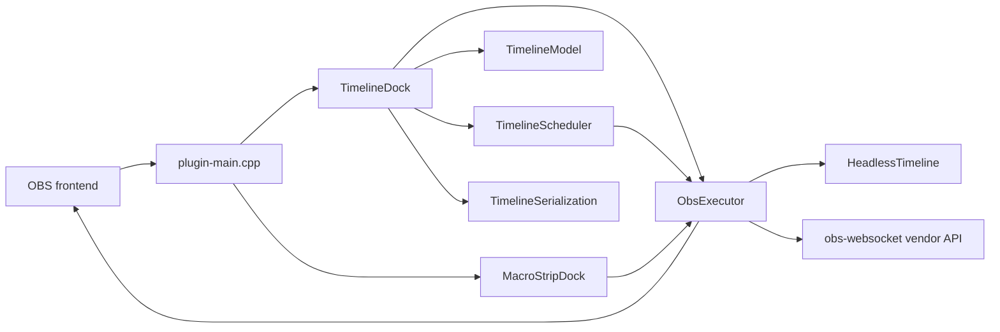

# Timeline for OBS architecture

This document is the maintainer reference for Timeline for OBS. It describes
the current implementation, the reasons for its major boundaries, the runtime
data flows, and the operational constraints that matter when extending the
plugin.

The code is authoritative. When this document disagrees with an implementation
detail, update the document after verifying the code rather than changing
runtime behavior to match the prose.

## Executive summary

Timeline for OBS is a Qt6 dock plugin that schedules OBS actions against a
monotonic playhead. The plugin separates event data, time progression, OBS
dispatch, and presentation into distinct components. The same model, scheduler,
and executor concepts also run without a UI for nested timeline files.

The main runtime path is:

```text
OBS loads the module
  -> plugin-main registers Timeline and Macro Strip docks
  -> TimelineDock owns TimelineModel, TimelineScheduler, and ObsExecutor
  -> scheduler emits eventStarted/eventEnded
  -> executor performs OBS actions
  -> dock persists timeline settings through TimelineSerialization
```

The plugin is currently a source-built Linux preview. CMake declares project
version `0.1.0` in `CMakeLists.txt:1-3`; the repository release state is
`v0.1.0-preview.1`. The module banner currently contains a hard-coded `1.0.0`
string in `src/plugin-main.cpp:55-78`, so that log message is not authoritative
for release identity.

## Audience and reading paths

Different maintainers need different entry points. Use the shortest path that
matches the work you are doing.

| Audience | Start here | Then read |
| --- | --- | --- |
| New contributor | `README.md` | `AGENTS.md`, this document |
| UI contributor | `src/timeline-dock.h:29-236` | `src/timeline-dock.cpp:341-2241`, `src/timeline-event-item.cpp:16-454` |
| Scheduler or action contributor | `src/timeline-scheduler.h:9-58` | `src/timeline-scheduler.cpp:4-211`, `src/obs-executor.cpp:49-423` |
| Persistence contributor | `src/timeline-serialization.h:9-40` | `src/timeline-serialization.cpp:4-127`, `src/timeline-model.cpp:75-180` |
| Nested timeline contributor | `src/headless-timeline.h:11-52` | `src/headless-timeline.cpp:8-90`, `src/obs-executor.cpp:373-423` |
| Release maintainer | `PACKAGING.md` | `docs/RELEASE_CHECKLIST.md`, `.github/workflows/linux-build.yml:15-33` |
| Test contributor | `tests/AGENTS.md` | `tests/CMakeLists.txt:13-46`, `tests/main_test.cpp:56-789` |

## System boundary

The plugin runs inside the OBS frontend process. It does not own OBS’s scene,
source, transition, hotkey, or WebSocket servers. It requests operations from
those APIs and keeps only short-lived references where the API requires them.



The module entrypoint creates both docks and connects the Macro Strip to the
Timeline dock's executor. This sharing prevents the two UI surfaces from
implementing different OBS action semantics (`src/plugin-main.cpp:55-72`).

### External dependencies

The build requires CMake, C++17, Qt6 Core/Gui/Widgets/Svg, and the OBS libraries
discovered through `pkg-config` (`CMakeLists.txt:1-18`). WebSocket vendor support
is optional. When `ENABLE_OBS_WEBSOCKET_VENDOR` is enabled and
`obs-websocket-api.h` is found, CMake defines `OBS_TIMELINE_HAS_WEBSOCKET=1`;
otherwise it compiles the integration out (`CMakeLists.txt:86-106`).

## Module map

Each module has one primary responsibility. The boundaries are deliberately
simple because the plugin runs in a host process where UI lifetime, OBS object
lifetime, and callback teardown must remain easy to trace.

| Module | Responsibility | Primary boundary |
| --- | --- | --- |
| `plugin-main.cpp` | OBS module registration, dock registration, module callbacks, Macro Strip persistence | OBS frontend API |
| `timeline-dock.cpp/.h` | Main timeline UI, editing, playhead, ruler, grid, import/export | Qt widgets and graphics scene |
| `timeline-model.cpp/.h` | Sorted event records and model mutation signals | Plain `TimelineEvent` data |
| `timeline-scheduler.cpp/.h` | Playhead clock, start/end detection, looping, finish signals | `TimelineModel` in, Qt signals out |
| `obs-executor.cpp/.h` | Translate timeline actions into OBS API calls | OBS frontend/libobs APIs |
| `headless-timeline.cpp/.h` | Run a nested timeline without a dock | Model + scheduler + executor |
| `timeline-serialization.cpp/.h` | Timeline JSON document format and atomic file I/O | `QJsonDocument` and `QFile` |
| `timeline-event-item.cpp/.h` | Render and drag one event bubble | `QGraphicsEllipseItem` |
| `event-editor.cpp/.h` | Modal event creation/editing and OBS target discovery | Qt dialog and OBS enumeration |
| `macro-strip-dock.cpp/.h` | Macro button UI and separate persistence | `MacroButtonModel` and shared executor |
| `macro-serialization.cpp/.h` | Macro button JSON format and atomic file I/O | `QJsonDocument` and `QFile` |
| `theme-helpers.h` | Theme-aware SVG paths and default colors | Qt palette and OBS theme widgets |
| `timecode-display.cpp/.h` | Theme-aware playback clock | Qt custom widget |

The source list is maintained manually in `CMakeLists.txt:27-62`. Adding a new
`.cpp` file requires adding it to `PLUGIN_SOURCES`; adding a header to
`PLUGIN_HEADERS` keeps it visible to the target and IDEs.

## Module lifecycle

OBS calls the module entrypoints defined in `plugin-main.cpp`. The lifecycle is
important because frontend callbacks and Qt objects must be unregistered before
their targets are destroyed.

### Load

`obs_module_load()` logs startup, creates `TimelineDock`, registers it as the
`timeline_dock` dock, creates `MacroStripDock`, registers it as
`timeline_macro_strip`, and gives Macro Strip the Timeline dock's executor
(`src/plugin-main.cpp:55-72`). `TimelineDock` constructs its model, scheduler,
executor, UI, callbacks, hotkeys, and initial configuration in that order
(`src/timeline-dock.cpp:49-97`).

### Post-load

`obs_module_post_load()` registers the optional `timeline` WebSocket vendor and
passes the vendor handle into the Timeline dock. It then loads Macro Strip data
after the dock exists (`src/plugin-main.cpp:106-126`).

### Unload

`obs_module_unload()` unregisters the Macro Strip frontend and save callbacks,
saves the Macro Strip, removes both docks, and schedules both widgets for Qt
destruction (`src/plugin-main.cpp:82-104`). `TimelineDock::~TimelineDock()` saves
the timeline, removes its frontend callbacks, unregisters its hotkeys, and clears
scene-owned ruler objects (`src/timeline-dock.cpp:99-111`).

### Frontend events

TimelineDock handles theme changes, scene collection changes, finished loading,
and OBS exit through `frontendEventCallback`. Qt work is queued back to the dock
thread (`src/timeline-dock.cpp:153-211`). Macro Strip handles theme changes by
rebuilding its button widgets (`src/macro-strip-dock.cpp:246-255`).

## Core data model

### TimelineEvent

`TimelineEvent` is the value object passed between the editor, model, scheduler,
executor, serialization layer, and tests (`src/event-types.h:21-36`). Its UUID is
generated during default construction.

| Field | Meaning |
| --- | --- |
| `id` | Stable UUID used by the model and graphics-item map |
| `timeMs` | Start position in milliseconds |
| `type` | One of the exposed or reserved `TimelineEventType` values |
| `sourceName` | Scene, source, hotkey, or fallback timeline name |
| `filterName` | Filter target for filter events |
| `data` | Type-specific QVariant payload, such as transition or file path |
| `color` | Bubble color, defaulting to cyan before type defaults are applied |
| `customIconPath` | Optional user-supplied SVG path |
| `label` | Optional event label |
| `showLabel` | Whether the label is rendered |
| `hasDuration` | Whether the scheduler emits an end event |
| `durationMs` | Duration in milliseconds |

The enum contains ten values, but `MediaSeek` is reserved and not exposed by
the editor. The editor exposes nine event types (`src/event-types.h:8-19`,
`src/event-editor.cpp:44-53`).

### Event semantics

The executor interprets duration and instant events differently:

| Type | Start action | End action when duration is enabled |
| --- | --- | --- |
| `SourceShow` | Make source visible | Hide source |
| `SourceHide` | Hide source | Make source visible |
| `MediaStart` | Restart media | Stop media |
| `MediaStop` | Stop media | Restart media |
| `FilterEnable` | Enable filter | Disable filter |
| `FilterDisable` | Disable filter | Enable filter |
| `SceneSwitch` | Switch scene | No end action |
| `HotkeyTrigger` | Trigger named hotkey | No end action |
| `TriggerTimeline` | Start nested file | No end action |

The mapping is implemented in `ObsExecutor::performAction()`
(`src/obs-executor.cpp:89-140`).

### TimelineModel

`TimelineModel` owns a `std::vector<TimelineEvent>`. Every add, remove, time
update, replacement, or JSON load emits `modelChanged()`; mutations that change
time or insert events maintain ascending `timeMs` order
(`src/timeline-model.cpp:9-13`, `src/timeline-model.cpp:33-65`,
`src/timeline-model.cpp:110-180`).

The model does not know about graphics items or OBS objects. Consumers retrieve
a const event vector, mutate through model methods, and react to
`modelChanged()`. This keeps event identity and ordering in one place.

### MacroButton

`MacroButton` is a compact action record with an ID, label, event type, target,
optional filter, serialized string data, and color (`src/macro-button.h:8-16`).
Macro buttons are not scheduled. Clicking one creates a temporary
`TimelineEvent` and calls the shared executor immediately
(`src/macro-strip-dock.cpp:112-125`).

## Scheduler architecture

The scheduler owns playback time, not OBS behavior. It uses a Qt timer with an
8 ms target interval, approximately 125 Hz, to reduce timing quantization for
fine BPM subdivisions (`src/timeline-scheduler.cpp:4-10`,
`src/timeline-scheduler.h:47-58`).

### Clock model

`currentOffsetMs` stores the paused or stopped playhead position. `startTime`
stores the wall-clock reference captured when playback resumes. While playing,
`getCurrentTime()` returns `currentOffsetMs` plus elapsed high-resolution clock
time (`src/timeline-scheduler.cpp:48-67`, `src/timeline-scheduler.cpp:131-139`).

This design means pause and resume preserve the playhead without accumulating
timer drift. `stop()` preserves the current position; `restart()` stops the
timer and seeks to zero (`src/timeline-scheduler.cpp:60-75`).

### Start and end detection

The model is sorted by start time, so the scheduler maintains
`nextStartIndex`. Each tick advances that cursor only through events whose
start time has arrived (`src/timeline-scheduler.cpp:185-199`). Duration end
times are not sorted by start time, so the scheduler retains a separate scan for
end events (`src/timeline-scheduler.cpp:201-210`).

`eventStartFired` and `eventEndFired` prevent repeated signals across timer
ticks. Seeking clears both sets and marks events strictly before the new
position as already fired. Model changes rebuild the sets while preserving
already-fired IDs and marking events strictly behind the playhead as fired
(`src/timeline-scheduler.cpp:11-39`, `src/timeline-scheduler.cpp:98-128`).

### End time and looping

When `endTimeMs` is positive and the current time reaches it, the scheduler
either resets to zero and emits `looped()` or pauses and emits `finished()`
(`src/timeline-scheduler.cpp:153-183`). The loop path emits a tick at zero before
the `looped()` signal so the dock can update its visual state in order.

### Scheduler signals

| Signal | Consumer | Meaning |
| --- | --- | --- |
| `tick(double)` | `TimelineDock` | Refresh playhead and time display |
| `eventStarted(TimelineEvent)` | `ObsExecutor` | Execute start action |
| `eventEnded(TimelineEvent)` | `ObsExecutor` | Execute duration end action |
| `finished()` | `TimelineDock` | Update playback UI after end time |
| `looped()` | `TimelineDock` | Persist or refresh loop state |

The Timeline dock connects these signals during construction
(`src/timeline-dock.cpp:60-64`). Headless timelines make the same scheduler to
executor connections without a UI (`src/headless-timeline.cpp:8-21`).

## OBS executor

`ObsExecutor` is the only component that translates timeline actions into OBS
frontend or libobs calls. It does not own the event model or determine when an
event fires.

### Scene switching and transitions

For a named transition, the executor finds and retains the matching OBS source,
retains the current transition, applies the requested transition, and switches
the scene (`src/obs-executor.cpp:143-196`). It schedules restoration using the
frontend transition duration, with a 300 ms fallback when OBS reports a
non-positive duration (`src/obs-executor.cpp:197-215`). Pending source references
are released when the callback runs or when the executor is destroyed
(`src/obs-executor.cpp:16-31`).

The executor uses `obs_frontend_source_list_free()` after transition
enumeration. `find_transition()` adds a reference to the selected source before
freeing the list (`src/obs-executor.cpp:143-165`). This reference pattern is
required whenever a source survives the list lifetime.

### Source visibility

The executor first checks the current scene. If the source is not found there,
it enumerates all frontend scenes and stops at the first matching scene item
(`src/obs-executor.cpp:259-303`). The fallback search is potentially expensive
for large scene collections, so callers should not move it into a high-frequency
render path.

### Media and filters

Media start and stop resolve a source by name and call
`obs_source_media_restart()` or `obs_source_media_stop()`
(`src/obs-executor.cpp:227-257`). Filter operations resolve the source, find the
named filter, toggle it, and release both source references
(`src/obs-executor.cpp:305-334`). Missing targets produce warnings rather than
throwing or terminating playback.

### Hotkeys

Hotkey execution enumerates registered hotkeys, stores the matching ID, stops
enumeration, and only then triggers the routed callback twice for press and
release (`src/obs-executor.cpp:336-371`). Collecting the ID first avoids
mutating the hotkey table while it is being enumerated.

### WebSocket vendor events

When compiled with WebSocket support and given a vendor handle, the executor
emits `TimelineEvent` notifications on event start and end. The payload contains
the event phase, numeric type, source name, and start time; it does not serialize
the complete QVariant payload (`src/obs-executor.cpp:49-87`). Playback status
notifications are emitted by the dock for started, paused, stopped, and finished
states (`src/timeline-dock.cpp:1259-1308`). Authentication and transport access
remain responsibilities of OBS WebSocket.

### Nested timelines

`TriggerTimeline` resolves its file path from `evt.data`, falling back to
`sourceName` for older records. It canonicalizes the path and rejects a request
whose path is already active (`src/obs-executor.cpp:373-395`). A successful
request creates a child `HeadlessTimeline`, stores it in `activeTimelines`,
connects its finish signal, and starts it (`src/obs-executor.cpp:397-417`).

`cancelAll()` stops active children and schedules them for deletion
(`src/obs-executor.cpp:38-47`). The child owns its model, scheduler, and executor
through Qt parent ownership (`src/headless-timeline.cpp:8-21`).

## Timeline dock and UI pipeline

`TimelineDock` is the composition root for the timeline UI. It owns the model,
scheduler, executor, graphics view, scene, controls, and event-item map
(`src/timeline-dock.h:29-236`). Its large surface area is intentional for the
current plugin, but all persistent event changes still pass through the model.

### Construction and persistence

Construction creates the core objects, registers Qt metatypes, builds the UI,
connects scheduler signals, installs a 250 ms save debounce timer, registers OBS
callbacks and hotkeys, then loads the module configuration
(`src/timeline-dock.cpp:49-97`).

The automatic timeline file is obtained through
`obs_module_get_config_path(..., "timeline.json")`, not the plugin install data
directory (`src/timeline-dock.cpp:221-304`). Manual Save and Load use a file
dialog and the same JSON document format (`src/timeline-dock.cpp:1373-1431`).

### Model-to-view synchronization

`modelChanged()` schedules one queued `rebuildEventItems()` call while no rebuild
is pending. This coalesces rapid changes such as paste or drag updates
(`src/timeline-dock.cpp:69-77`). During an event drag, rebuilds are deferred and
re-scheduled on mouse release (`src/timeline-dock.cpp:1231-1253`).

`rebuildEventItems()` sorts indices by event time, assigns stack lanes, creates
or updates `TimelineEventItem` objects keyed by event ID, removes stale items,
and updates labels and tooltips (`src/timeline-dock.cpp:1874-2050`). The map is
keyed by UUID so multiple events at the same time remain distinct.

### Timeline interaction

The viewport event filter implements:

- Context-menu event insertion at a clicked time.
- Control-wheel stepped zoom.
- Horizontal wheel scrolling.
- Playhead scrubbing.
- End-marker dragging.
- Hover time display.

These paths are implemented in `src/timeline-dock.cpp:1067-1257`. Event items
handle their own drag, hover, selection, edit, color, and delete signals
(`src/timeline-event-item.cpp:165-225`). The dock converts those signals into
model mutations in `src/timeline-dock.cpp:1830-1872`.

### Grid, snapping, and BPM

Time mode uses the selected manual interval. BPM mode computes the interval as
`(60 / bpm) * noteLengthBeats * 1000`, which is shared by grid rendering,
placement, and item snapping (`src/timeline-dock.cpp:1346-1362`). The editor and
context menu placement flow snap the requested time before creating the event
(`src/timeline-dock.cpp:1802-1835`).

### Graphics item lifecycle

`TimelineEventItem` combines `QObject` signals with `QGraphicsEllipseItem`
rendering. It keeps its time centered under zoom changes, constrains movement to
the timeline bounds, and draws duration lines, icons, selection rings, hover
glows, and optional labels (`src/timeline-event-item.cpp:16-75`,
`src/timeline-event-item.cpp:227-343`, `src/timeline-event-item.cpp:403-454`).

The item owns a `QSvgRenderer` and synchronously replaces it when the event type,
color, or custom icon changes (`src/timeline-event-item.cpp:122-135`). Do not
change this to `deleteLater()` without re-evaluating rapid rebuild behavior.

### Keyboard shortcuts

The dock registers Space, Delete, Home, copy, and paste shortcuts. Space uses
`WidgetWithChildrenShortcut` but ignores activation while a line edit or combo
box has focus (`src/timeline-dock.cpp:683-696`). Left and Right nudge selected
events by one second; Shift reduces the nudge to 100 ms
(`src/timeline-dock.cpp:1471-1499`). OBS hotkey callbacks always queue Qt work
back to the dock (`src/timeline-dock.cpp:129-151`).

## Persistence and file formats

### Timeline JSON

The current timeline format is a root object with `events` and `settings`.
`TimelineSerialization::toJsonObject()` writes the complete settings set
(`src/timeline-serialization.cpp:4-29`).

```json
{
  "events": [
    {
      "id": "uuid",
      "time": 1500,
      "type": 0,
      "source": "Scene 1",
      "color": "#4a90e2",
      "data": "Fade"
    }
  ],
  "settings": {
    "loop": false,
    "endTime": 0,
    "snap": false,
    "snapIntervalMs": 500,
    "bpm": 120,
    "gridToBpm": false,
    "noteLengthBeats": 1,
    "centerControls": false,
    "alternatingBg": false,
    "compactMode": false,
    "showEndTimeOnDock": true,
    "currentTimeMs": 0,
    "zoomPixelsPerSecond": 100
  }
}
```

Bare JSON arrays remain accepted as legacy event-only files. Object documents
use defaults for omitted settings, while invalid root types and malformed files
return an error string (`src/timeline-serialization.cpp:31-68`,
`src/timeline-serialization.cpp:106-126`).

Timeline saves are atomic at the file level: the serializer writes a `.tmp`
file, closes it, removes the old file, and renames the temporary file into place
(`src/timeline-serialization.cpp:70-103`). The same pattern is used for Macro
Strip data (`src/macro-serialization.cpp:74-101`).

### Timeline event serialization

`TimelineModel::toJson()` omits optional fields when they are at their defaults.
`fromJson()` generates IDs for legacy events without IDs, validates the enum
range, supports legacy `target` fields, and restores colors, labels, duration,
and type-specific data (`src/timeline-model.cpp:75-174`).

### Macro Strip JSON

Macro data uses an object with `buttons` and `version`. Each button stores its
ID, label, type, source, optional filter, optional data, and color
(`src/macro-serialization.cpp:9-29`). Invalid event types are skipped, duplicate
or missing IDs are regenerated, and malformed files are renamed with a
`.broken-<timestamp>` suffix by Macro Strip loading
(`src/macro-serialization.cpp:32-72`, `src/macro-strip-dock.cpp:229-244`).

### Storage locations

| Data | Path or API | Owner |
| --- | --- | --- |
| Installed binary | `${TIMELINE_PLUGIN_ROOT}/bin/64bit/timeline.so` on Linux | CMake install (`CMakeLists.txt:108-126`) |
| Installed plugin data | `${TIMELINE_PLUGIN_ROOT}/data/` | CMake install (`CMakeLists.txt:118-130`) |
| Timeline settings | `obs_module_get_config_path(..., "timeline.json")` | OBS module config API (`src/timeline-dock.cpp:221-253`) |
| Macro buttons | `~/.config/obs-studio/plugins/timeline/data/macro_buttons.json` | Macro Strip (`src/macro-strip-dock.cpp:213-227`) |
| Manual timeline export | User-selected JSON path | Timeline dock (`src/timeline-dock.cpp:1373-1395`) |

## Threading and ownership

The plugin has no custom worker thread. Qt widgets, models, schedulers, and
executors run on the owning Qt thread. The scheduler timer and its signal chain
therefore execute in that thread (`src/timeline-scheduler.cpp:4-10`,
`src/timeline-dock.cpp:60-64`).

### OBS callbacks

OBS hotkey callbacks can arrive outside the Qt UI thread. The static callbacks
do not touch widgets directly; they queue the corresponding dock slot
(`src/timeline-dock.cpp:129-151`). Frontend callbacks also queue UI work for
theme, collection, loading, and exit events (`src/timeline-dock.cpp:153-211`).

### Qt ownership

The dock parents its model, scheduler, executor, scene, controls, and timers.
Headless timelines parent their model, scheduler, and executor to the headless
controller (`src/timeline-dock.cpp:49-54`, `src/headless-timeline.cpp:8-14`).
Nested timelines are removed from the active list and scheduled for deletion
after finishing (`src/obs-executor.cpp:403-415`).

### OBS source references

Every source returned by `obs_get_source_by_name()` or frontend getters is
released after use. Sources selected from frontend lists receive an additional
reference before the list is freed when the operation outlives the list
(`src/obs-executor.cpp:143-165`, `src/obs-executor.cpp:173-224`). Any future
deferred OBS operation must document and retain its references explicitly.

## Failure modes and recovery

The plugin favors warnings and safe no-ops over terminating the OBS process.

| Failure | Current behavior | Evidence |
| --- | --- | --- |
| Timeline file missing | Create a default document directory/file | `src/timeline-dock.cpp:285-297` |
| Timeline JSON malformed | Log a warning and leave the current load operation | `src/timeline-dock.cpp:260-272`, `src/timeline-serialization.cpp:106-126` |
| Scene/source/filter missing | Log a warning; continue scheduler operation | `src/obs-executor.cpp:221-334` |
| Transition name missing | Log a warning and use the normal scene switch path | `src/obs-executor.cpp:175-185` |
| Nested file missing or invalid | Schedule child deletion and log a warning | `src/obs-executor.cpp:397-422` |
| Nested recursion | Reject the canonical path already active | `src/obs-executor.cpp:387-395` |
| Macro file malformed | Rename it to a timestamped `.broken-*` file | `src/macro-strip-dock.cpp:229-244` |
| OBS exit during queued UI work | Queued work uses QObject context and teardown unregisters callbacks | `src/timeline-dock.cpp:99-111`, `src/timeline-dock.cpp:153-211` |

Persistence uses replace-by-rename, but the implementation removes the old
file before renaming the temporary file. A filesystem failure during that small
window can lose the previous file; release testing must cover the target
filesystem and permissions.

## Security and data protection

Timeline for OBS does not implement accounts, authentication, authorization, or
network listeners. The optional WebSocket integration registers a vendor with
OBS WebSocket; access control remains in OBS WebSocket rather than this plugin
(`src/plugin-main.cpp:106-121`, `src/obs-executor.cpp:53-87`).

The plugin reads and writes local JSON files. Timeline paths can be selected in
the event editor and nested timeline paths are opened directly by Qt
(`src/event-editor.cpp:60-76`, `src/headless-timeline.cpp:35-70`). Treat imported
timeline files as trusted local configuration: they can cause OBS scene,
source, filter, media, and hotkey operations when played.

The plugin does not execute shell commands or interpret JSON as code. It passes
event fields to OBS APIs and Qt file APIs. A future network or command event
must define validation, authorization, and disclosure rules before implementation.

## Performance characteristics

The scheduler uses an 8 ms timer and a monotonic start cursor. Start detection
advances through each event once per forward pass; duration end detection remains
O(n) per tick because end times are not ordered by start time
(`src/timeline-scheduler.cpp:185-210`). This is appropriate for the expected
small-to-medium timeline sizes, but duration-heavy timelines remain the first
candidate for profiling.

The dock avoids unnecessary graphics work in three ways:

- `modelChanged()` coalesces rebuilds through a queued invocation
  (`src/timeline-dock.cpp:69-77`).
- Ruler and grid caches skip redraws when their relevant dimensions and settings
  are unchanged (`src/timeline-dock.cpp:994-1006`, `src/timeline-dock.cpp:1629-1650`).
- Playhead and end-marker pixmaps are cached by color
  (`src/timeline-dock.h:196-200`, `src/timeline-dock.cpp:1735-1770`).

Potentially expensive operations include scene-wide source visibility fallback
search (`src/obs-executor.cpp:287-297`), OBS target enumeration in the editor
(`src/event-editor.cpp:193-355`), and full event-item rebuilds after model
changes (`src/timeline-dock.cpp:1874-2050`). None runs in an OBS graphics
render callback.

## Deployment architecture

The plugin builds as a CMake `MODULE` named `timeline` with no `lib` prefix and
links Qt6 and OBS libraries (`CMakeLists.txt:64-84`). CMake installs the module
and `data/` directory under the configured plugin root
(`CMakeLists.txt:108-130`).

The default Linux workflow uses Ninja, RelWithDebInfo, and CTest
(`.github/workflows/linux-build.yml:15-33`). The repository also defines CMake
presets for Ubuntu, macOS, and Windows, but the current public preview and CI
workflow documented for contributors is Linux source build
(`CMakePresets.json:18-100`, `README.md:101-129`).

### Build switches

| Switch | Default | Effect |
| --- | --- | --- |
| `CMAKE_CXX_STANDARD` | `17` | Required language standard |
| `ENABLE_OBS_WEBSOCKET_VENDOR` | `ON` | Attempt optional vendor-header integration |
| `TIMELINE_PLUGIN_ROOT` | `$HOME/.config/obs-studio/plugins/timeline` | Root for installed binary and data |
| `OBS_PLUGIN_DESTINATION` | `${TIMELINE_PLUGIN_ROOT}/bin/64bit` | Installed module directory |
| `OBS_DATA_DESTINATION` | `${TIMELINE_PLUGIN_ROOT}/data` | Installed data directory |

The test target compiles the executor, headless timeline, scheduler, model,
event item, serialization, macro, and editor sources with mocked frontend and
WebSocket functions (`tests/CMakeLists.txt:13-46`).

## Testing strategy

Tests run through Qt Test with an offscreen platform and a headless OpenGL
context for OBS startup (`tests/main_test.cpp:50-87`). The suite covers executor
dispatch, model operations, scheduler signals and loops, serialization,
graphics-item behavior, Macro Strip behavior, and dock layout checks
(`tests/main_test.cpp:231-789`).

Run the full suite from a configured build:

```bash
cmake --build build
ctest --test-dir build --output-on-failure
```

Run an individual QTest function when narrowing a regression:

```bash
build/tests/run_tests testSceneSwitch
build/tests/run_tests testSchedulerStartCursorResets
```

The test doubles are intentionally incomplete OBS source implementations. They
verify dispatch and lifetime paths but cannot prove all behavior of real OBS
scene, media, filter, transition, or graphics objects (`tests/AGENTS.md:25-30`).
The release checklist therefore requires a real OBS smoke test in addition to
the automated suite (`docs/RELEASE_CHECKLIST.md:11-49`).

## Design decisions and trade-offs

### Model, scheduler, and executor are separate

The scheduler decides *when* an event fires, while the executor decides *how*
OBS performs it. This keeps timing tests independent of OBS source setup and
lets HeadlessTimeline reuse the same action path.

### Qt signals connect the layers

Signals avoid direct model-to-view and scheduler-to-OBS coupling. The trade-off
is that queued model rebuilds and QObject teardown must be understood before
changing item lifecycle code (`src/timeline-dock.cpp:69-77`).

### JSON uses value objects and defaults

The model stores plain event values and serialization applies defaults for
missing settings. This keeps old event arrays loadable while allowing new
settings to be added without requiring every file to contain every key
(`src/timeline-serialization.cpp:31-68`).

### Nested timelines reuse the runtime triple

HeadlessTimeline avoids a second execution model for nested files. The trade-off
is one scheduler, model, executor, and timer per active nested timeline, plus
the need for canonical-path recursion checks (`src/headless-timeline.cpp:8-21`,
`src/obs-executor.cpp:387-417`).

### Graphics items own presentation state

TimelineEventItem owns visual state such as colors, labels, compact mode, and
drag constraints, while the dock owns event identity and model synchronization.
This lets the item handle pointer interaction without making it responsible for
persistence (`src/timeline-event-item.h:24-72`, `src/timeline-dock.cpp:1927-2018`).

## Extension guidance

When adding a new event type, update all of the following surfaces together:

1. Add the enum value in `src/event-types.h:8-19`.
2. Add an editor option and target discovery path in
   `src/event-editor.cpp:44-53` and `src/event-editor.cpp:193-355`.
3. Define start/end semantics in `ObsExecutor::performAction()` at
   `src/obs-executor.cpp:89-140`.
4. Add the event icon and default color in `src/theme-helpers.h:283-361`.
5. Add display text and tooltip handling in
   `src/timeline-dock.cpp:1966-2018`.
6. Confirm JSON enum validation accepts the value in
   `src/timeline-model.cpp:120-127` and `src/macro-serialization.cpp:45-58`.
7. Add executor, scheduler, serialization, and UI coverage where the behavior
   is observable.
8. Update `README.md`, this reference, and the release checklist when the new
   behavior changes user-facing or operational expectations.

When adding a new persistent setting, update `TimelineDocument`,
`toJsonObject()`, `fromJsonDocument()`, `applyTimelineDocument()`, the default
document path, and serialization tests. When adding a new dock callback,
unregister it in the matching destructor or module unload path.

## Troubleshooting guide

### The dock does not appear

Check that the module was installed under the configured plugin root, that OBS
can load the module, and that `obs_module_load()` reaches dock registration
(`src/plugin-main.cpp:55-65`). Inspect OBS logs for missing Qt, OBS, or optional
WebSocket dependencies.

### Events fire at the wrong time

Check the event's stored `timeMs`, the scheduler's current offset, the selected
snap interval, and whether the scheduler has reached its end time
(`src/timeline-scheduler.cpp:98-175`, `src/timeline-dock.cpp:1346-1370`). Use
`testSchedulerStartCursorResets` for cursor and seek regressions.

### A transition appears to be cut short

The executor restores a named transition after the frontend transition duration,
using 300 ms when OBS reports no duration
(`src/obs-executor.cpp:197-215`). Verify the frontend duration and inspect for
another action changing the current transition during that interval.

### A nested timeline does not start

Verify that the event contains a readable JSON path, that the file is an array
or object document, and that its canonical path is not already active
(`src/headless-timeline.cpp:35-70`, `src/obs-executor.cpp:373-422`).

### Tests produce graphics warnings

The test harness creates an offscreen surface and OpenGL context before OBS
startup, but test-harness shutdown can still emit graphics-context warnings in some
environments (`tests/main_test.cpp:65-87`, `tests/AGENTS.md:27-30`). Treat test
failures separately from known shutdown warnings.

## Glossary

| Term | Definition |
| --- | --- |
| Event | A `TimelineEvent` value scheduled at a start time |
| Event item | The `QGraphicsEllipseItem` that renders one event |
| Playhead | The current scheduler position shown in the dock |
| Tick | One scheduler timer callback, targeted at an 8 ms interval |
| Start cursor | Sorted index used to avoid rescanning future event starts |
| Duration event | An event with a positive duration and an end signal |
| Timeline document | Root JSON object containing events and settings |
| Headless timeline | A model/scheduler/executor runner with no UI |
| Macro button | An immediate, unscheduled action shown in Macro Strip |
| Coalesced rebuild | Queued model-to-view rebuild collapsed across rapid mutations |
| Transition restoration | Delayed return to the previous OBS transition after a named switch |

## References

The architecture reference describes implementation boundaries; these files
provide procedures and local conventions:

- `README.md` — user-facing features, installation, and usage.
- `PACKAGING.md` — configure, build, install, and smoke validation.
- `docs/RELEASE_CHECKLIST.md` — release acceptance checks.
- `AGENTS.md` — repository-wide engineering and safety constraints.
- `src/AGENTS.md` — UI, OBS ownership, and callback rules.
- `tests/AGENTS.md` — test target structure and test-double limitations.
- `data/AGENTS.md` — localization and asset rules.
