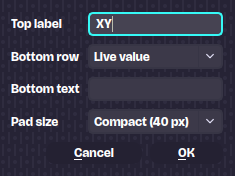
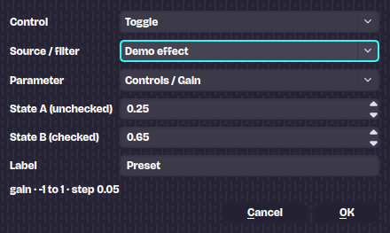

# Timeline and Macro Strip usage guide

The [README](../README.md) is the quick start. This guide describes action
semantics, binding behavior and operational details for the current preview.

## Recording live Macro Strip adjustments

Press **Record** in the Timeline toolbar while playback is stopped. The
recording starts at the current playhead time and uses elapsed wall time for
subsequent gestures; it does not start Timeline playback. Move a Macro Strip
slider, knob, or XY pad, or use a numeric/boolean toggle. Only a successful
write to the selected OBS source/filter property produces a sample. Ordinary
OBS property readback and timeline-generated changes do not enter the take.

Press **Record** again to finish; the new parameter cues are added to the
current document in one undoable edit. Each continuous numeric segment is a
linear ramp with editable endpoints, easing, and duration. Separate gestures
more than 750 ms apart do not acquire an artificial fade across the pause.
Boolean changes remain instantaneous. Edits retain the existing exact source
and filter UUID targets; missing targets remain unresolved rather than being
silently redirected.

- No source or filter parameter changes occur merely by arming recording.
- Stop the recording before Play. While armed, the regular Play/Stop buttons
  are disabled; a playback or restart hotkey finishes the current take first.
- A 120-second or 1,200-sample capture bound automatically finishes the take.
  Sample coalescing reduces dense movement writes; this is not lossless
  audio-rate motion capture.
- Recording a take changes the *timeline document*, not Macro Strip bindings.
  Use Undo to remove the entire take, or edit individual generated events.
- Text control edits, external OBS property changes, and third-party plugin
  changes not made through Macro Strip are deliberately excluded. No general
  automation input bus or live parameter feedback recording is implied.
- If recording remains armed during a normal OBS shutdown, the buffered take
  is committed before Timeline performs its final save. Loading a different
  timeline cancels any uncommitted take.

## Toolbar layout

New timelines default to centered playback, clock and zoom controls.
Existing explicit alignment preferences are preserved. Center controls
can be toggled in the settings menu. The clock and zoom group are
separated using the same native divider as the other toolbar groups.

## Action behavior

### Scene switch

Optionally select a named transition. Timeline restores the previous
transition after the OBS frontend's transition duration, with a fallback
delay when OBS reports no duration. Rapid switches replace a pending
restoration timer rather than stacking restore callbacks.

### Source visibility

The editor lists scene items in the current scene, including groups and
nested scenes, with their paths and item IDs. New explicit targets use the
owner UUID, item ID and source UUID, so renames or program-scene switches
don't redirect the action. Missing explicit targets are skipped. A shared
nested scene has shared underlying scene items, and changing an item does
not change the visibility of its parent containers.

Legacy name-based actions keep their old lookup behavior until explicitly
retargeted. Older builds do not understand the new exact-target payload.

### Media playback

Restart, Stop, Pause, Resume and Seek to are grouped under Media Playback.
Restart invokes OBS's restart operation, rather than resuming a paused
source. The picker discovers controllable media sources across scenes,
including nested scenes and groups, and lists each source UUID once.
New bindings survive source renames; old name-based bindings retain their
original behavior.

Seek is in seconds with millisecond precision, clamped to known media
duration. Actual media playback depends on the source implementation.
Historical `MediaSeek` (ID 3) stays reserved; the new `MediaSeekTo` action
has a separate ID. Older builds may not understand current media targets.

### Durations

| Action | Default end action |
| --- | --- |
| Show / Hide | Hide / Show |
| Filter Enable / Disable | Disable / Enable |
| Media Restart / Stop | Stop / Restart |
| Media Pause / Resume | Resume / Pause |
| Downstream Keyer Scene | Hide overlay |

These are the historical default end actions. Enable **Duration**, then
choose **At end** to override that default. Visibility can explicitly
show/hide, filters enable/disable, media restart/stop/pause/resume, and
Downstream Keyer can hide or select another named overlay on the same keyer.
**Leave unchanged** performs no OBS operation at the end. These choices
operate on the original target; they are not snapshots of arbitrary prior
OBS state. Existing files without an ending state retain their default.
An unknown explicit ending state skips execution rather than reversing.
Older builds ignore explicit ending states, so use the current build for
these cues. Freeze Time delays duration endings along with other cues.
Scene switches, hotkeys, nested timeline triggers, seek and instantaneous
parameter cues do not have an automatic end action. Numeric parameter
ramps instead finish at their defined endpoint.

### Setting a parameter

Select **Set Parameter Value**, then **Choose parameter and value**. Use the
live source/filter picker to choose an exposed numeric, boolean or text property,
and define its value using the appropriate editor.

Configuration does not apply a value. Without Duration, the event sets the
property once, clamping and quantizing to the live range and step. A missing
or invalid binding is skipped instead of selecting a different target.
A value remains set until another action or manual adjustment changes it.

A Macro Strip action button can use the same event type as an immediate
preset. Live controls bound to that property reflect its changed value.

### Animating a parameter

In **Set Parameter Value**, select an integer or float property and set its
starting value. Enable **Duration**, enter the ending value, and select
an easing curve (Linear, Ease in, Ease out, or Ease in/out). The non-linear
curves use quadratic easing. The cue's duration bar represents the logical
animation span. The final value remains set after the span finishes.

Samples follow the timeline clock: pause and Freeze Time halt interpolation,
and playback resumes from the same logical progress. Scrubbing does not
apply OBS changes; starting playback within a ramp resumes at the
corresponding progress. Seeking past a completed ramp does not replay it.
A later numeric, boolean or text cue for the same exact binding in the
same timeline supersedes an earlier ramp, including its eventual ending.
Simultaneous ramps on different bindings can run together. A separate
timeline or manual control can still write the same property; there is
no global automation lock.

All samples respect the live property range and step. Coarse integer or
float steps produce stepped motion, and mixer volume interpolates in OBS
fader position rather than linear gain. Missing or incompatible targets
are skipped. Boolean and text values remain instantaneous. Macro Strip
does not offer scheduled ramps. Older builds reject the version-2
parameter payload instead of treating it as a version-1 instant value.
Do not resave new timelines using those builds.

### Freeze Time

Add a Freeze Time cue and set its wait in seconds (up to 24 hours). The
playhead holds at the marker while OBS continues running normally. The
clock resumes automatically; later cues and timeline-duration endings
are delayed without changing their saved timestamps. Cues on the same
marker timestamp still execute together, and coincident holds accumulate.
The clock border highlights while waiting; hover for remaining time.
Manual pause preserves remaining wait; seek cancels the active wait and
restart clears it. A new pass through the marker waits again. Nested
timelines use their own clock. Other OBS media and independent timers
are not paused. Active wait progress is not persisted across sessions.

### Conditional Scene Switch

With a compatible URL/API Source provider, enable **Share parsed data with
OBS plugins** and select a single numeric or boolean result in its request
parser. Enable background operation on the provider if it must remain
available while not visible.

Add a **Conditional Scene Switch** cue, choose the destination scene, select
the Data Source, set a comparison and maximum age (100–60000 ms), and save.
Numeric comparisons are greater/less than or equal; boolean comparisons
require an actual JSON true or false. Numeric-looking strings are not numbers.

At the cue timestamp, Timeline reads the provider's latest cached result,
without issuing a network request. It switches using the current OBS
transition only if the condition is true and the result is fresh. False,
missing, stale, malformed or unshared data skips the cue permanently for
that pass; playback does not wait. A later loop or replay evaluates it again.
The source binding uses its UUID, so renaming does not redirect it. Missing
providers never redirect to another source. There is no duration or inverse
action and this cue is not offered in Macro Strip. Ordinary cues work
without the companion plugin. Older Timeline builds skip the new event ID;
do not resave the file with an older build.

### Finding hotkeys

Select **Hotkey Trigger** in either editor. Search by description, registered
ID or source/group. The picker groups recognized Move filter hotkeys by
their owning source, other source-registered hotkeys by source name, and
frontend/plugins, outputs, encoders and services separately.

Group headings aren't selectable. New hotkey bindings store registerer type,
owner identity (source UUID, or internal output/encoder/service name) and
the registered hotkey name. The current session's numeric hotkey ID is
resolved at execution. Source renames and hotkey re-registration do not
redirect the cue. Exact identities that are missing or ambiguous do not
execute. The picker excludes ambiguous complete identities; filtering a
saved choice out of the list does not silently select a replacement.

Legacy name-only hotkeys retain their former first-match behavior until
explicitly retargeted. Missing selections remain editable without losing
their stored binding. Older plugin builds ignore the new owner payload:
use the current build to execute these cues safely.
This picker does not change OBS Settings → Hotkeys or assign shortcuts.
OBS exposes registerer types but not reliable plugin identity for all
frontend hotkeys. Move animations are still performed by Move.

### Downstream Keyer scene

Requires Exeldro's Downstream Keyer and OBS WebSocket API support. The editor
accepts the keyer name and overlay scene; a blank scene hides the overlay.
A blank view/canvas addresses the primary output. The overlay scene must
already belong to the named keyer's scene list.

The request uses the in-process OBS WebSocket vendor API, not a remote
network connection, so no credentials or enabled remote server are needed.
Missing vendors, invalid names and unavailable APIs are logged.

## Timeline editing and playback

- Events can be placed at the playhead, a double-click or a right-click
  position. Exact time edits and layout changes preserve event timestamps.
- Choose Time mode for a manual snap interval or BPM mode for beat
  subdivisions. Zoom spans 5–1,000 pixels per second.
- Drag the playhead to seek and the optional end marker to set the limit.
- Overlapping events stack into lanes. Compact mode updates the toolbar,
  timecode and event dimensions and recalculates stacking. Extra lanes
  scroll vertically (including the ruler); ordinary wheel scrolling remains
  horizontal and Ctrl + wheel zooms.
- Cues exactly at a positive end marker execute before stopping or looping.
  Delayed ticks dispatch due starts/ends in chronological order, with ends
  before starts at equal timestamps. This cannot restore elapsed presentation
  time. Durations extending beyond an explicit end are not automatically
  shortened or cleaned up.
- OBS frontend hotkeys are registered for play/pause, stop and restart.

### Undo and redo

The Undo/Redo actions at the top of the Timeline menu and dock-local
shortcuts share the last 100 event edits in memory. Add/remove, dragging, timestamps, labels, colors, icons, durations
and action parameters are restored. Batch paste, deletion and nudging take
one undo step. No-op edits retain redo; a new edit after undo discards redo.
A successful document load clears history.

History edits do not execute OBS actions. History is disabled while playing,
loading or dragging, and excludes playhead movement, zoom, grid settings,
end-marker changes, Macro Strip edits and selection. It is not saved to disk.
The normal autosave path persists the resulting event data.

## Live parameter controls

Macro Strip mixes immediate action buttons with live numeric sliders/knobs
boolean/preset toggles and editable text controls. The shared parameter catalog walks scenes, nested
groups, standalone sources, attached filters and exposed property groups.
It reads the property's current type, range, increment and unit suffix.

Choose the control type before selecting a source/filter and parameter.
Sliders and knobs list numeric properties only, toggles accept supported
scalar properties, and text entries list editable strings only. Changing between compatible
control types retains the selected binding; an incompatible property
selection clears and must be chosen again. XY axis pickers remain numeric;
the timeline defined-value picker still accepts all supported scalar types.

Bindings store source UUID, optional filter UUID, property key and scalar
type. Renames retain identity. Added/removed targets and changed property
definitions are reflected in the open assignment dialog, refreshed about
once per second. Refresh is deferred while a dropdown is open or the
defined-value editor is being edited. Missing choices require reassignment.

Visible live controls read current settings about four times per second
and refresh their schemas about every two seconds. Loading macros doesn't
reset the source values. Changes are applied through a typed, one-property
OBS settings update; continuous adjustments are coalesced and flushed on
release, while toggles apply immediately. The target plugin remains
responsible for applying the setting.

Knobs use a 32-pixel rotary face with a theme-colored 270-degree progress
arc and position pointer. Relative vertical movement is unchanged:
160 logical pixels for a full wide-range drag, up to eight pixels per
discrete step for smaller ranges. Shift scales movement to one tenth.
There is no click-to-angle jump, and reversing at either limit responds
immediately. Wheel and arrow keys adjust one step when focused.
Parameter caption columns reserve width when created or when theme metrics
change, not when values or availability change. Long captions elide in
place, preserving control alignment and neighboring positions.

Only visible, enabled integer, float, boolean and ordinary editable text
settings are discoverable (numeric controls are limited to one million
increments). List/color/button properties, custom ranges, scene-item
transforms and manual ramp controls are not included in Macro Strip.

### Labels and appearance



Right-click any control and choose **Labels and appearance** to rename
the top label independently of its action or binding. By default only
the top label appears, styled as a compact theme-aware tag. The bottom
row is optional: choose None, Custom text, or Live value (for numeric,
boolean and XY controls). Text entries and action buttons support custom
bottom text. When any control uses a second caption, the strip reserves
a shared bottom row so all controls stay aligned. Values remain readable
in tooltips even when the live value row is hidden. Caption widths are
fixed between configuration changes. XY pad size can be selected here
without changing either axis binding.

### XY controllers

Choose **+ → XY controller**, assign a numeric property to each axis,
and name the control. X increases to the right; Y increases upward.
Click or drag in the pad to set both values. Focus the pad and use the
arrow keys to adjust the corresponding axis by a single property step.
Axes can bind to different sources or filters, but not the same property.
The square pad defaults to 40 logical pixels, with 48 and 64 pixel
options in Labels and appearance. Its caption does not resize as values change. A strip without an XY control
keeps its ordinary row height.

Both bindings are saved, and values are read from OBS without writing on
startup. A missing axis disables the whole pad rather than redirecting
a write. Drag writes are coalesced; release commits the latest pair.
Same-source settings properties travel in one settings update. Separate
sources or mixer operations are validated before writing, but cannot be
updated transactionally across OBS objects. Right-click to edit or remove
the control. Older builds cannot read XY macro records; keep a backup
before downgrading.

### Two-state toggles



Choose Toggle and bind a supported scalar property. Booleans use the ordinary
unchecked/checked false/true behavior. For integer, float or editable text
properties, define State A (unchecked) and State B (checked). Numeric presets
are snapped to the declared step, and the two states must remain distinct.
Text presets are exact strings, including empty or multiline strings.
No values are applied when configuring or loading the toggle.

The checkbox reads the actual OBS value, including changes from a timeline
or another control. A third value displays as indeterminate; the next click
selects A. A subsequent click selects B. Both presets are validated against
the live schema before writing; invalid or missing targets disable the toggle.
The optional live caption reports the active preset or Other value.
Earlier versions cannot read non-boolean preset toggles; back up macros before
downgrading. List/enum and color properties remain unsupported.

### Text controls

Choose Text entry to expose editable text properties. Single-line fields
use an inline entry and an explicit **Apply** button, keeping unsubmitted
edits separate from the live value. External updates refresh clean entries
without replacing a draft. Multiline properties open an editable text
dialog, with OK to apply and Cancel to leave the source unchanged. This
keeps the strip compact regardless of text length. Drafts are not persisted.
The field retains normal text editing and clipboard behavior; use the
caption or surrounding control for the binding menu.

Text can also be assigned by Set Parameter Value, including empty strings,
Unicode and multiline content. The shared binding editor does not apply
text when configuring a cue. Password and informational text properties
are never offered. Writes revalidate the current property schema.

### Native mixer controls

Audio-capable sources expose **Mixer / Volume (fader position)** and
**Mixer / Mute** in the same parameter picker, even without corresponding
OBS settings properties. Use a slider or knob for volume, or a toggle for
mute. The volume uses the OBS logarithmic fader curve; 0–100% represents
fader travel in 0.1% increments, not a linear audio multiplier. Its tooltip and optional live value row show the corresponding dB value. At zero it reads -inf dB and
at 100% it reaches unity (0 dB). Positive gain above unity is outside
this control's range; readback saturates at the maximum. Mute is independent
of volume. External mixer adjustments are read back without resetting values.
Both are available for instantaneous Set Parameter Value cues; volume
also supports numeric animation.

Missing sources, filters or properties disable the control rather than
redirecting it by name. The dock aligns its rows using the native theme's
control sizes and reserves room for the horizontal scrollbar. Both docks
follow OBS palette and theme changes, keeping event colors and custom SVG
artwork intact. Theme refreshes do not discard unfinished text edits.

## Plugins and integrations

Open **Settings → Plugins & Integrations** in Timeline to see loaded OBS
modules. A supported adapter has a checkbox that enables adding its action
in both editors. Downstream Keyer is the first such adapter; it requires
WebSocket support at build time.

The checkboxes control available new actions, not OBS plugin loading or
execution of previously saved events. Saved unavailable actions retain
their fields. Preferences are saved in `integrations.ini`.

Dedicated action adapters are separate from dynamic property bindings:
compatible scalar properties can be exposed by other plugins without a
Timeline-specific adapter.

When built with the optional OBS WebSocket vendor header, Timeline can
emit `TimelineEvent` and playback status events. Event notifications carry
the phase, numeric type, source name and time. OBS WebSocket owns
authentication and transport; Timeline has no separate network listener.

## Saving and recovery

Settings save in the writable per-plugin configuration directory using
atomic file writes. Timeline edits debounce for 250 ms, Macro Strip edits
for 300 ms. Timeline documents accept the current object format and legacy
bare event arrays. See the [file formats](ARCHITECTURE.md#persistence-and-file-formats).

Default Linux locations:

```text
~/.config/obs-studio/plugin_config/timeline/timeline.json
~/.config/obs-studio/plugin_config/timeline/macro_buttons.json
```

A valid legacy installed Macro Strip file at
`~/.config/obs-studio/plugins/timeline/data/macro_buttons.json` is imported
if the canonical config is absent, without deleting the original.
Scene-collection copies are recovery backups, not replacements for a
newer authoritative file or unsaved edits.

If saving Macro Strip fails, changes remain authoritative in memory until
a successful retry or shutdown. Check OBS logs and available storage
before exiting. Windows/macOS use their respective OBS configuration
locations.

Back up documents before downgrading. Old builds may ignore explicit
target identities or discard unsupported action IDs and parameter-control
records after saving. Never rely on an old build to execute a new UUID-based
action safely.

Only import and play files you trust: playback can switch scenes,
change visibility, control media and properties, trigger OBS hotkeys and
run nested files.

## Further reading

[Build and installation](../PACKAGING.md) ·
[Architecture](ARCHITECTURE.md) ·
[Release checklist](RELEASE_CHECKLIST.md)
